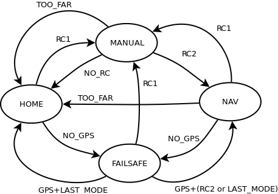
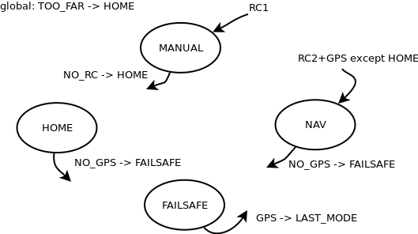

# Autopilot generation

```{note}
Archived documentation: the description and limitations reflect the wiki revision below. The basic example illustrates the design and is not a ready-to-fly autopilot.
```


This page presents the idea and configuration of a custom autopilot formal description, included to the [airframe file](https://wiki.paparazziuav.org/wiki/Airframe_Configuration) and leading to code generation.

## General Concepts

The core part of an autopilot consists in a finite state machine, where each state corresponds to a **mode** and the transitions are the conditions to change between modes (based on user request or triggered by event). The firmwares of Paparazzi (fixedwing, rotorcraft) have list of built-in modes (ex: [Rotorcraft_Configuration#Mode](https://wiki.paparazziuav.org/wiki/Rotorcraft_Configuration#Mode)) and it is not so easy to add or remove one to the list, usually restricted to core developers. In addition, for each mode a certain control stack will be called, and even if it is possible to choose the actual control loops being used, possibilities are limited and it is not possible to run several one in parallel (especially useful when developing new control schemes).

With this in mind, a formal description of the autopilot, for both the state machine (mode list, transitions between modes) and control stack have been developed in integrated to Paparazzi. The description is done in a XML file, and when adding the autopilot to the airframe file, C code will be automatically generated and integrated to the airborne code in place of the static autopilot used by default in your firmware.

## State Machine example

Here is an example of basic autopilot modes represented as a state machine:



This AP has 4 modes, 2 normal ones (MANUAL and NAV) and 2 safety modes (HOME, FAILSAFE). The modes are controlled from a switch on the remote control (RC1, RC2) and several events (NO_GPS, NO_RC, TOO_FAR) can lead to bring the aircraft back to HOME or start a FAILSAFE procedure. Even this simple example has a lot of transitions and it would have been difficult to describe all of them for complex autopilots.

In order to make things a bit easier, for each mode, the selection conditions and exit (exception) conditions are described, which allows to group implicitly most of the transitions:



Now, the 11 transitions are replaced by 2 **select** conditions, 3 local and 1 global **exception** conditions.

## XML file description

Some autopilot description file are already available for the [fixed wing firmware](https://github.com/paparazzi/paparazzi/blob/master/conf/autopilot/fixedwing_autopilot.xml) or (a part of the) [rotorcraft firmware](https://github.com/paparazzi/paparazzi/blob/master/conf/autopilot/rotorcraft_autopilot.xml). They must be located in the **conf/autopilot** folder of your Paparazzi project.

- autopilot: main node containing several state machine
  - name: the autopilot name
- state_machine: at least one is needed (the core of the autopilot, **ap** for fixedwing, **main** for rotorcraft, but other ones can be added to describe sub-modes for instance)
  - name: the name of the state machine
  - freq: calling frequency (flags, like CONTROL_FREQUENCY can be used to automatically adapt to the firmware configuration)
  - gcs_mode: true or false if modes should be used in the GCS strip (only one can be set to true)
  - settings_mode: true or false if modes should appear as settings in the GCS dedicated pane
  - settings_handler: function handler for settings if needed
- modules: aircraft [modules](https://wiki.paparazziuav.org/wiki/Modules) can be loaded directly from the autopilot when it requires specific configuration or control blocks
- includes: some header files can be included by hand, on the long term it should be replaced by modules import
- settings: GCS [settings](https://wiki.paparazziuav.org/wiki/Settings) can be described directly from the autopilot
- control_block: when a control stack is called in several modes (for instance the attitude stabilization) a meta block can be described for a cleaner description
- exceptions: global exceptions that should be applied to all modes
- mode: describe each mode (transition and control stack)
  - name: mode name
  - shortname: short name
  - gcs_name: name for GCS strip display

### Mode description

Each mode should describe the transitions' conditions (**select** and **exceptions**) and the control stack.

- select
  - cond: on which condition this mode should be selected
  - exception (optional): don't apply the condition if currently in a given mode
  - the condition **\$DEFAULT_MODE** can be used to select the startup mode (only one allowed) if not the first one
- on_enter: a list of functions to call when entering the mode
  - call
    - fun: function (or a piece of C code to call)
    - cond (optional): a condition to call the function
- control: a list of **call** and **call_block** to be called at each control loop
  - freq (optional): the frequency of this part of the control stack (max freq if not specified)
- exception: a list of exit conditions for this mode
  - cond: the exit condition
  - deroute: the mode to reach if exception is met (**\$LAST_MODE** keyword can be used to go back to the previous mode)
- on_exit: a list of functions to call when exiting the mode
  - call
    - fun: function (or a piece of C code to call)
    - cond (optional): a condition to call the function

### Control blocks

Control blocks are a collection of functions to call that can be reused in several modes with the tag **call_block**.

- control_block
  - name: the name of the control block
  - call
    - fun: function (or a piece of C code to call)
    - cond (optional): a condition to call the function

### Basic example

This is an example of implementation of the above basic autopilot (not actually working with Paparazzi)

The imported example has been corrected to close `control_block` and escape
`&&` as `&amp;&amp;` in XML. Placeholder functions still need implementation.

**File: conf/autopilot/my_ap.xml**

```xml
 <autopilot name="My basic AP">

   <state_machine name="ap" freq="CONTROL_FREQUENCY" gcs_mode="true" settings_mode="true">

     <includes>
       <include name="some_header.h"/>
       <include name="nav.h"/>
       <include name="guidance/guidance.h"/>
       <include name="stabilization/stabilization_attitude.h"/>
       <include name="subsystems/gps.h"/>
       <include name="autopilot_rc_helpers.h"/>
     </includes>

     <control_block name="attitude">
       <call fun="attitude_loop()"/>
       <call fun="set_actuators()"/>
     </control_block>

     <exceptions>
       <exception cond="TOO_FAR()" deroute="HOME"/>
     </exceptions>

     <mode name="MANUAL">
       <select cond="RC1()"/>
       <control>
         <call fun="set_actuators_from_RC()"/>
       </control>
       <exception cond="NO_RC()" deroute="HOME"/>
     </mode>
     <mode name="NAV">
       <select cond="$DEFAULT_MODE"/>
       <select cond="RC2() &amp;&amp; GPS()" exception="HOME"/>
       <control freq="4">
         <call fun="navigation_loop()"/>
       </control>
       <control>
         <call fun="guidance_loop()"/>
         <call_block name="attitude"/>
       </control>
       <exception cond="NO_GPS()" deroute="FAILSAFE"/>
     </mode>
     <mode name="HOME">
       <control freq="4">
         <call fun="nav_home()"/>
       </control>
       <control>
         <call fun="guidance_loop()"/>
         <call_block name="attitude"/>
       </control>
       <exception cond="NO_GPS()" deroute="FAILSAFE"/>
     </mode>
     <mode name="FAILSAFE">
       <control>
         <call fun="failsafe_landing()"/>
         <call_block name="attitude"/>
       </control>
       <exception cond="GPS()" deroute="$LAST_MODE"/>
     </mode>

   </state_machine>

 </autopilot>
```

## Airframe file configuration

In order to use your generated autopilot, just add the following line to the firmware section of your airframe file:

```xml
<autopilot name="your_ap_name.xml"/>
```

This should be enough to generate the code and switch to the generated code handling in the airborne code.

## Limitations

This new features is still in development. It means that it has some limitations and should be used with care.

1.  The state machine graph is not tested to check for possible errors, loops, oscillation between modes, ... The user should test properly all the modes and transition on the ground and in simulation before a real flight with a newly designed autopilot
2.  Some mode names are explicitly called in the airborne code (especially for the fixedwing firmware). It is then recommended to keep the existing modes making problems (MANUAL, AUTO1, AUTO2, ...) and add new ones if needed.
3.  The current control loops are all implementing the same "API", which makes it easy to replace one by an other in the initial design, but is problematic if they should be used in parallel (like a primary controller and a backup one) in the new design. Future improvements or new control loops design should take care to avoid reusing the same variables (each code should have its own "namespace") and the autopilot description should make the like between each control stack appropriately.
4.  The selection of a mode follows this procedure (with only one pass, description order does matter):
    1.  evaluate the "select" conditions for all modes (until one is valid, or stay in current mode)
    2.  evaluate the "exception" conditions for the selected mode (until one is valid, or stay in current mode)
    3.  evaluate the global "exceptions" for the selected mode (until one is valid, or stay in current mode)
5.  Probably a lot more... but so many new possibilities !

## Attribution

Imported from [Autopilot generation](https://wiki.paparazziuav.org/wiki/Autopilot_generation), wiki revision [24088](https://wiki.paparazziuav.org/w/index.php?oldid=24088) (2018-05-15). Contributors: Ghattenb, Fabien-B. Images copied from the local wiki archive.
