# Apogee

This page documents the **Apogee v1.00** autopilot board.

::::{container} pinout

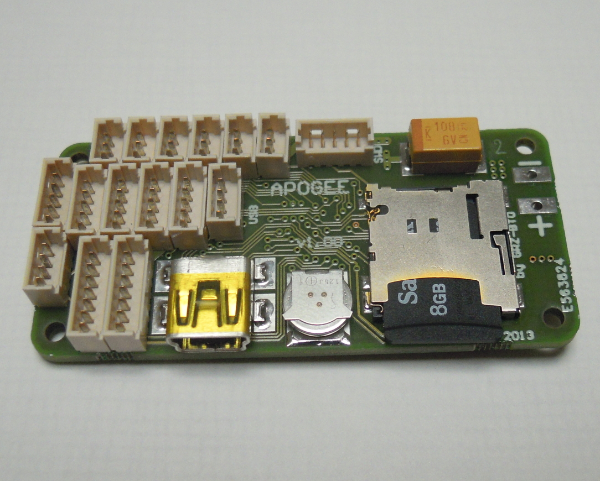

## Overview

- STMicroelectronics STM32F405RGT6 Cortex M4 168MHz processor featuring a Floating point unit (FPU), up to 192k of RAM and 1024k of FLASH.
- 9(6) DOF integrated IMU MPU-9150(6050) based
- 1 x Barometer/altimeter MPL3115A2 (I2C, MPU slave capability)
- 1 x MicroSD card slot, 4 bit SDIO interface (high speed data logging)
- 1 x USB : DFU mode (download) or USB storage (direct access to MicroSD card)
- 6 x Servo PWM outputs
- 1 x R/C receiver PPM frame input
- 1 x R/C receiver serial input with inverter (Futaba S.BUS, Spektrum, etc.)
- 3 x UART
- 2 x [I2C](http://en.wikipedia.org/wiki/I2c) bus
- 1 x [SPI](http://en.wikipedia.org/wiki/Serial_Peripheral_Interface) bus
- RTC with backup capacitor
- SWD(ARM download/debug interface)
- 4 x Auxiliary I/O (General Purpose and/or ADC and/or servo PWM)
- 5v / 1.5A switching power supply (input voltage range 5.5V min → 17.0v max)
- 3.3v / 1A linear regulator
- 1 x 5v / 500mA power switch
- 4 x status LEDs
- 10.4 grams (0.37 oz)
- 53 x 25mm (2.1" x 0.98"), shares the same external dimensions and mounting points as UmarimLite
- 4 layers PCB design

## Hardware Revision History

| Version # | Release Date | Release Notes |
| --- | --- | --- |
| v1.00 | 07/2013 | Initial release of Apogee |

## Detailed Features

### SDIO (MicroSD card)

- software support available with **v5.2** and above
- hi-cap power designed to give enough time to cleanly save buffer and close file(s) when power outage detected
- USB-storage mode when plugging an USB cable after startup

### 6 or 9 DOF IMU

Apogee v1.00 PCB offer two [Invensense](http://www.invensense.com/) IMU chip options:

- [MPU-6050](http://www.invensense.com/mems/gyro/mpu6050.html) : 6 DOF, 3 axis Accelerometer + 3 axis Gyroscope
- [MPU-9150](http://www.invensense.com/mems/gyro/mpu9150.html) : 9 DOF, 3 axis Accelerometer + 3 axis Gyroscope + 3 axis Magnetometer

### USB Modes

- usb plugged before autopilot is powered : enter DFU mode to be flashed
- usb plugged after autopilot is powered : stop ap task, enter usb storage mode to made sdcard content easily avalaible, after the host has mounted;copied;dismounted storage;unplugged usb, ap restart

### SWD: Serial Wire Debug

permits flash and source level debugging via swd part of cheap discovery card, or via more capable, fastest, more expensive probe like black magic probe

(apogee-rc-serial)=

### R/C Serial

In addition to the classic PPM input, that mostly require receiver modification, one pin of the R/C connector is routed to the MCU UART2 receive input through a **controlled inverter**.  
This new feature allow **direct connection** (3 pin) of several brand off-the-shelf receivers **without hardware modification** or external encoder board.

- **RX2_POL(PB13) = 0** =\> R/C serial (Rx2) is **non-inverted** : allow use standard polarity serial receivers (Spektrum, FlyElectric...)
- **RX2_POL(PB13) = 1** =\> R/C serial (Rx2) is **inverted** : allow use of S.BUS protocol compatible receivers (Futaba, FrSky,...)

(see [R/C Receivers and Radios page](https://wiki.paparazziuav.org/wiki/RC_Receivers_and_Radios) for serial compatible receiver)

### Real Time Clock

supercap powered rtc, permit to associate correct time and date on sdcard log files, when ap is unpowered between flights

(apogee-power-switch)=

### Power Switch

**5V** power output pin on **AUX connector** ("5Vaux",#2) **can be switched ON and OFF** on demand using APSW (MCU GPIO output PB12).

- APSW = 0 =\> 5V Aux OFF
- APSW = 1 =\> 5V Aux ON (default)

The internal switch TPS2051B is designed to withstand 500mA continuous current and is **short-circuit and thermally protected**.  
(see [TPS2051B](http://www.ti.com/product/tps2051b) datasheet for recommended operation conditions)

## Pictures

- 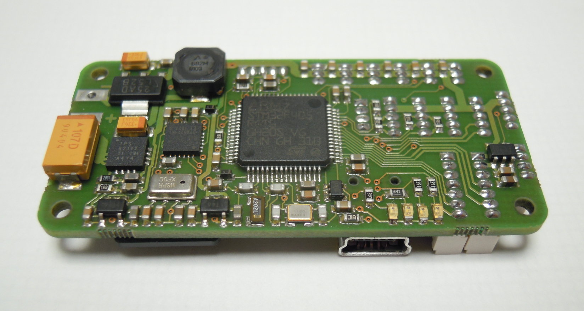

  Apogee v1.00 bottom view

- 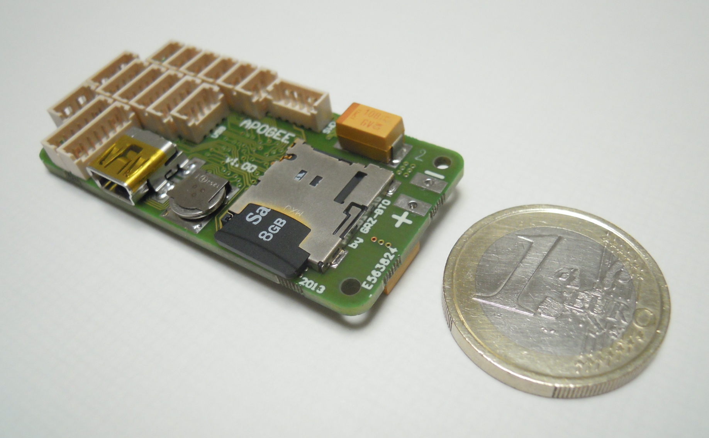

  Apogee v1.00 top view

## Pinout

*Pins Name and Type are specified with respect to the Autopilot Board*

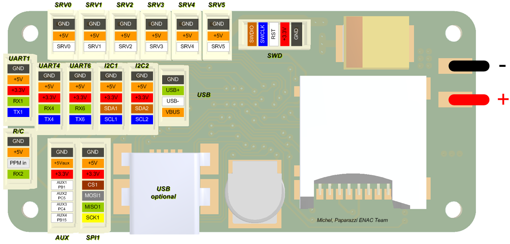

**SRV0/1/2/3/4/5**

| Pin # | Name | Type | Description |
| --- | --- | --- | --- |
| 1 | GND | PWR | common ground |
| 2 | +5V | PWR | 5V Rail from autopilot |
| 3 | SRVx | OUT | Servo signal (PWM) |

**R/C**

| Pin # | Name | Type | Description |
| --- | --- | --- | --- |
| 1 | GND | PWR | common ground |
| 2 | +5v | PWR | 5V Rail from autopilot |
| 3 | PPM in | IN | PPM Stream from R/C Receiver (5V tolerant) |
| 4 | RX2 | IN | UART2 Serial Input (5V Tolerant) through [controlled inverter](#apogee-rc-serial) |

**UART1/4/6**

| Pin # | Name | Type | Description |
| --- | --- | --- | --- |
| 1 | GND | PWR | common ground |
| 2 | +5V | PWR | 5V Rail from autopilot |
| 3 | +3.3V | PWR | 3.3V Rail from autopilot |
| 4 | RX1/4/6 | IN | UART1/4/6 Serial Input (3.3V level, UART1 and UART6 are 5V tolerant, UART4 IS *NOT* 5V tolerant) |
| 5 | TX1/4/6 | OUT | UART1/4/6 Serial Output (3.3V level) |

**I2C1/2**

| Pin # | Name | Type | Description |
| --- | --- | --- | --- |
| 1 | GND | PWR | common ground |
| 2 | +5V | PWR | 5V Rail from autopilot |
| 3 | +3.3V | PWR | 3.3V Rail from autopilot |
| 4 | SDA1/2 | Open Drain I/O (1.5k pull-up) | I2C1/2 bus Serial DAta |
| 5 | SCL1/2 | Open Drain I/O (1.5k pull-up) | I2C1/2 bus Serial CLock |

**USB**

| Pin # | Name | Type | Description |
| --- | --- | --- | --- |
| 1 | GND | PWR | common ground |
| 2 | USB+ | I/O | USB bidirectional D+ line |
| 3 | USB- | I/O | USB bidirectional D- line |
| 4 | VBUS | IN | Indicates the presence of USB bus power (5V level), DFU or USB storage Mode selection |

*Note: MiniUSB and Molex USB connectors are in parallel, only one can be connected at a time.*

**SPI1**

| Pin # | Name | Type | Description |
| --- | --- | --- | --- |
| 1 | GND | PWR | common ground |
| 2 | +5V | PWR | 5V Rail from autopilot |
| 3 | +3.3V | PWR | 3.3V Rail from autopilot |
| 4 | CS1 | OUT | Slave Select. Selects the SPI slave (PB9) |
| 5 | MOSI1 | I/O | SPI1 Master Out Slave In. Data output from master / data input to slave |
| 6 | MISO1 | I/O | SPI1 Master In Slave Out. Data input to master / data output from slave |
| 7 | SCK1 | I/O | SPI1 Serial clock. Clock output from master or input to slave |

**AUX**

| Pin # | Name | Type | Port | Description |
| --- | --- | --- | --- | --- |
| 1 | GND | PWR |  | common ground |
| 2 | +5Vaux | PWR |  | 5V from autopilot through [Power Switch](#apogee-power-switch) |
| 3 | +3.3V | PWR |  | 3.3V Rail from autopilot |
| 4 | AUX1 | I/O | PB1 | General Purpose I/O #1 or ADC_1 Input or PWM6 |
| 5 | AUX2 | I/O | PC5 | General Purpose I/O #2 or ADC_2 Input |
| 6 | AUX3 | I/O | PC4 | General Purpose I/O #3 or ADC_3 Input |
| 7 | AUX4 | I/O | PB15 | General Purpose I/O #4 (also spektrum bind pin) |

**SWD**

| Pin # | Name | Type | Description |
| --- | --- | --- | --- |
| 1 | GND | PWR | common ground |
| 2 | +3.3V | PWR | 3.3V Rail from autopilot |
| 3 | RST | IN | MCU Reset |
| 4 | SWCLK | IN | Serial Wire Clock |
| 5 | SWDIO | I/O | Serial Wire Data Input/Output |

## Schematic

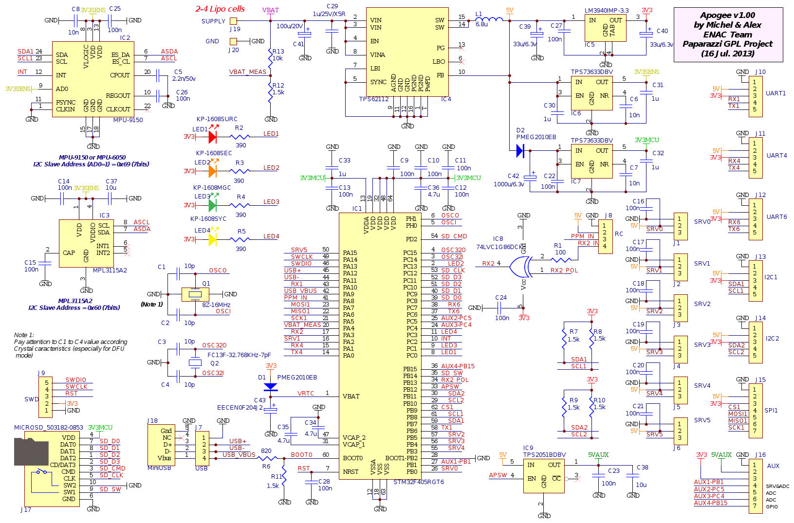

## PCB

### Gerber & Drill Files

PCB design [Eurocircuits 6-C class](http://www.eurocircuits.com/images/stories/ec09/ec-classification-english-1-2010-v2.pdf) compliant:

***[Download Apogee v1.00 gerber & drill files (zip)](downloads/apogee/Apogee_v100_gerber_files.zip)***

RS274X, units = Inches, format = 2:5

- Apogee_v100_Silkscreen_TOP.GBR (Top Component Print Layer)
- Apogee_v100_Soldermask_Top.GBR (Top Solder Mask)
- Apogee_v100_Paste_Mask_Top.GBR (Top Paste Mask, stencil)
- Apogee_v100_Signal_Top.GBR (Top Copper Layer)
- Apogee_v100_Internal_Plane_1.GBR (Internal Copper Layer GND)
- Apogee_v100_Internal_Plane_2.GBR (Internal Copper Layer +3.3V)
- Apogee_v100_Signal_Bottom.GBR (Bottom Copper Layer)
- Apogee_v100_Paste_Mask_Bottom.GBR (Bottom Paste, stencil)
- Apogee_v100_Soldermask_Bottom.GBR (Bottom Solder Mask)
- Apogee_v100_Outline.GBR (Board Outline)
- Apogee_v100_Drill.GBR (NC XY coordinates & Drill tools sizes)

## Assembly

### Components Layout

- 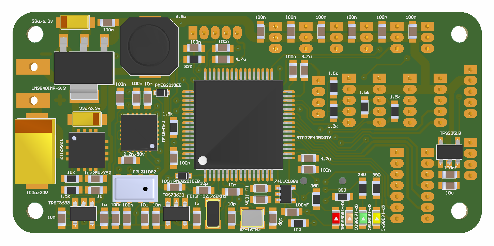

  Apogee v1.00 bottom components Layout

- 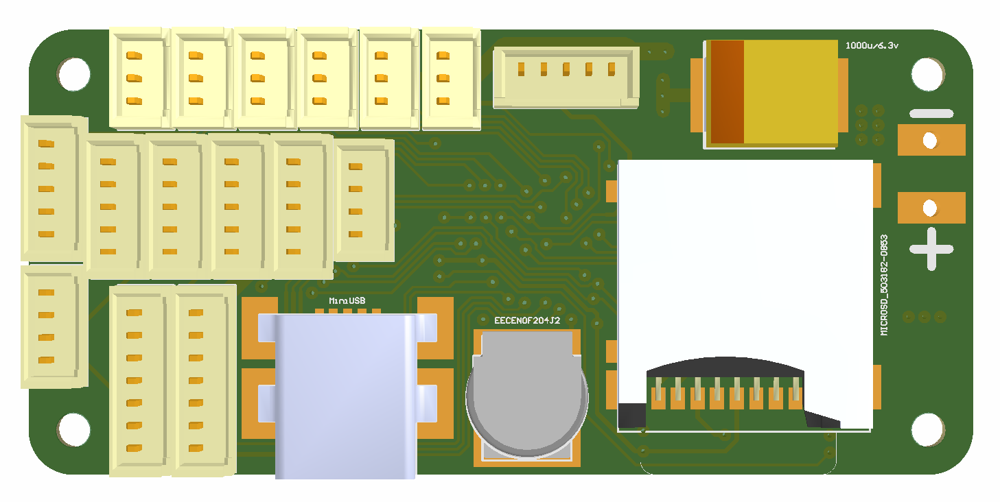

  Apogee v1.00 top components Layout

- 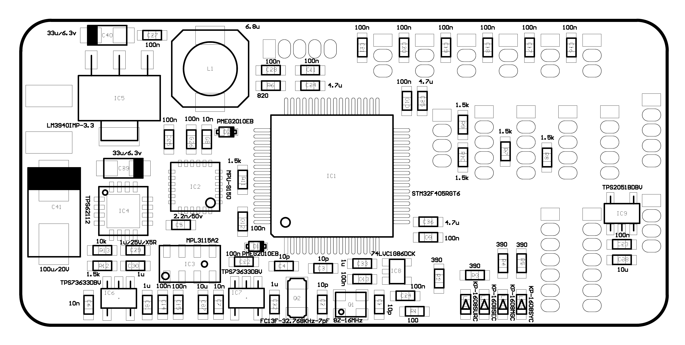

  Apogee v1.00 bottom components detail

- 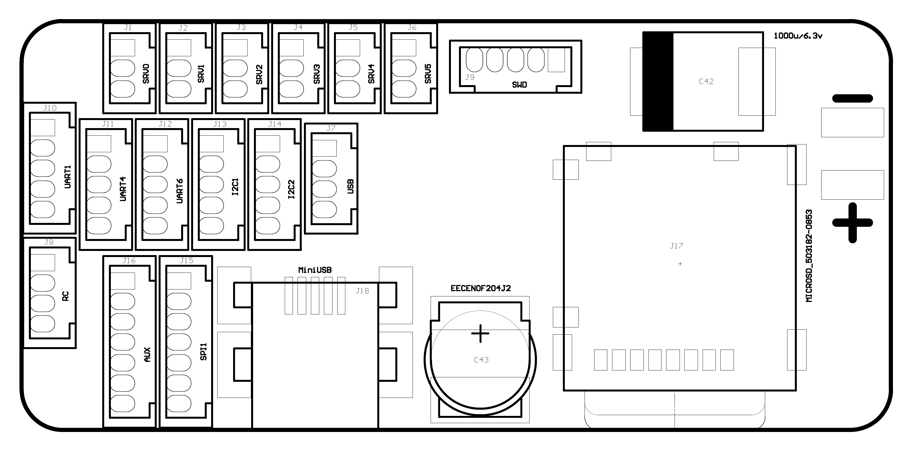

  Apogee v1.00 top components detail

### Bill Of Material

***[Download Apogee v1.00 Bill of Material (zipped .xls file)](downloads/apogee/Apogee_v100_BoM.zip)***  

### PCB and assembled boards suppliers

Check availability on [Get Hardware](https://wiki.paparazziuav.org/wiki/Get_Hardware) page

## Mechanical Dimensions

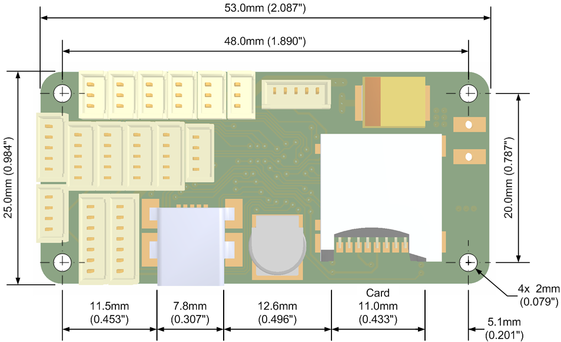 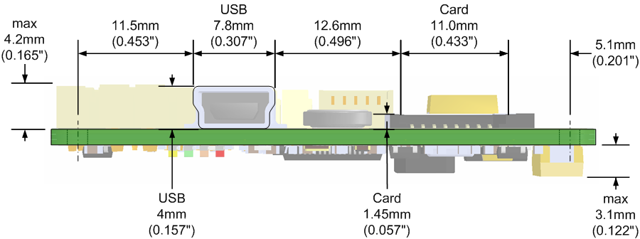

## Programming

Apogee autopilot can reprogrammed in two different ways:

- using the MCU native (embedded in rom) DFU USB bootloader over the on-board USB header (so pre-loading an "external" bootloader is useless)
  - required hardware : usb cable with usb-mini connector
  - required software : dfu_util tool (present in ubuntu repository)
- using the SWD (Serial Wire Debug) connector
  - required hardware : usb cable with usb-mini connector, molex to 2.54mm pitch pin cable, swd part of a cheap stm32 evaluation board (any discovery board, start @ 8\$)
  - required software : st_flash and st_util, have to be compiled from source (<https://github.com/texane/stlink>)

## Debugging

### Debugging with STM Discovery ST-LINK/V2 embedded debug tool

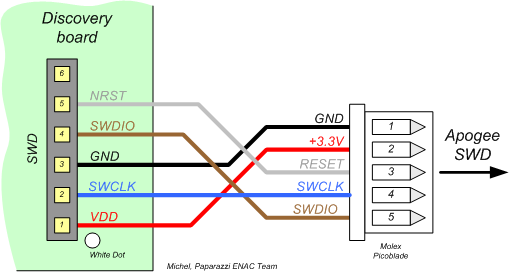

### Debugging with [CricketProbe](https://wiki.paparazziuav.org/wiki/CricketProbe/v1.00)

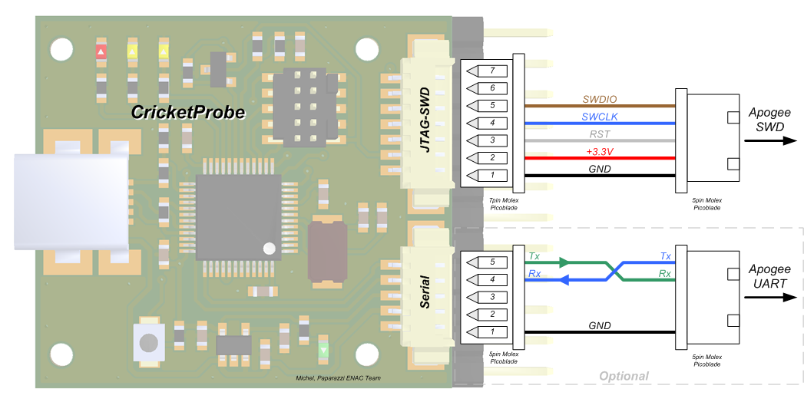

### Debugging with Black Magic Probe

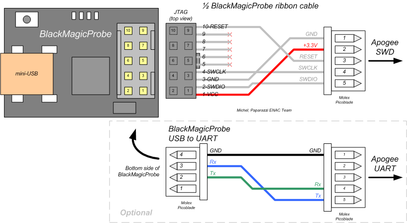

## Source Files

*[Apogee v1.00 hardware design (zipped Protel99SE SP6 database file)](downloads/apogee/Apogee_v100_Protel_Design.zip)*
