# Chimera

This page documents the **Chimera v1.00** autopilot board.

::::{container} pinout

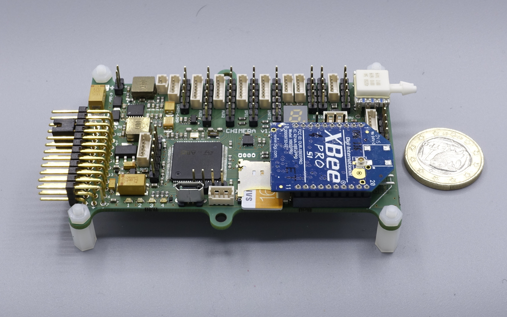  

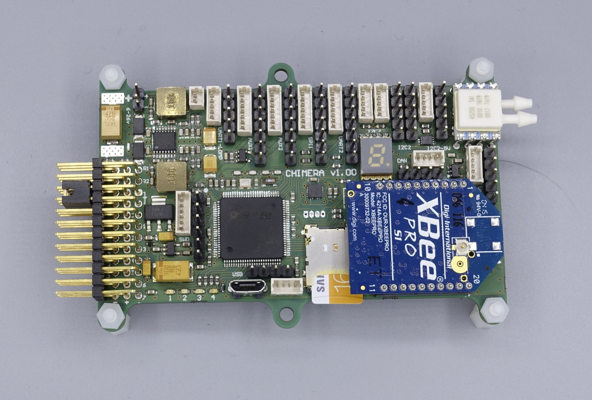

## Overview

- STMicro **STM32F767** Micro Controller Unit
  - *ARM Cortex-M7, 216 MHz CPU, FPU & DSP instructions, 2 Mbytes Flash, 512 Kbytes SRAM, General-purpose DMA,etc.*
  - *Unlike STM32F4, FPU of STM32F767 [double precision](https://en.wikipedia.org/wiki/Double-precision_floating-point_format) capable. It means* ***double precision computation is 10 times faster on chimera** than on STM32F4 based hardware*
- **9 DOF Inertial Measurement Unit**
- **Barometer/altimeter** *(I2C, IMU slave capability)*
- **Differential Pressure Sensor for Pitot tube**
- **microSD card** *(+ dedicated power supply for emergency files closing system)*
- All connectors available both in **standard 0.1” header and Molex Picoblade** *(except servos and R/C receiver, 0.1” header only)*
- **Dedicated serial link and power supply for "Companion Computer"** *(Beaglebone, Raspberry, Gumstix, ...)*
- x4 status Leds + **8 segments LED display**
- SWD debug connector *(STM STLink compliant header)*
- **x8 Servos** *(+ **Servos Power supply selection capabilities**: Chimera onboard power supply or external source)*
- **x2 RC Receiver inputs** *(S.BUS, PPM & Spektrum Satellite compatible, including receiver binding)*
- **x5 UARTs** *(including one with hardware flow control signals)*
- **x1 I2C** bus *(3.3V and 5V logic level)*
- **x1 SPI** bus *(with Slave Select, Master or Slave)*
- **x1 CAN** bus
- **x8 auxiliary Inputs/Outputs** spread over 2 connectors *(x6 ADC, x6 Timers different from servos, x1 UART, x1 DAC)*
- **XBEE modem** holder *(ASSO and Reset connected to MCU GPIOs)*
- **x1 USB** :
  - *DFU mode (download) or USB storage (direct access to MicroSD card)*
  - *micro-USB plug (+ Picoblade & 0.1” header in //)*
  - *Board can be flashed even if aircraft battery is off)*
- Controlled Powerswitch 5V supply on AUX A (AUX0 to 3) header
- **Twin switching power supply** :
  - *source **2 to 6 Lipo cells** (6 to 26v)*
  - *5v/3A for “Companion” Computer(controlled by GPIO)*
  - *5v/3A dedicated to Chimera (servos and other 5v peripherals)*
- VBat+Gnd connectors for peripheral
- 89x60mm (3.5x2.4")

## Hardware Revision History

| Version # | Release Date | Release Notes |
| --- | --- | --- |
| v1.00 | 10/2016 | Initial release of Chimera |

## Pictures

- 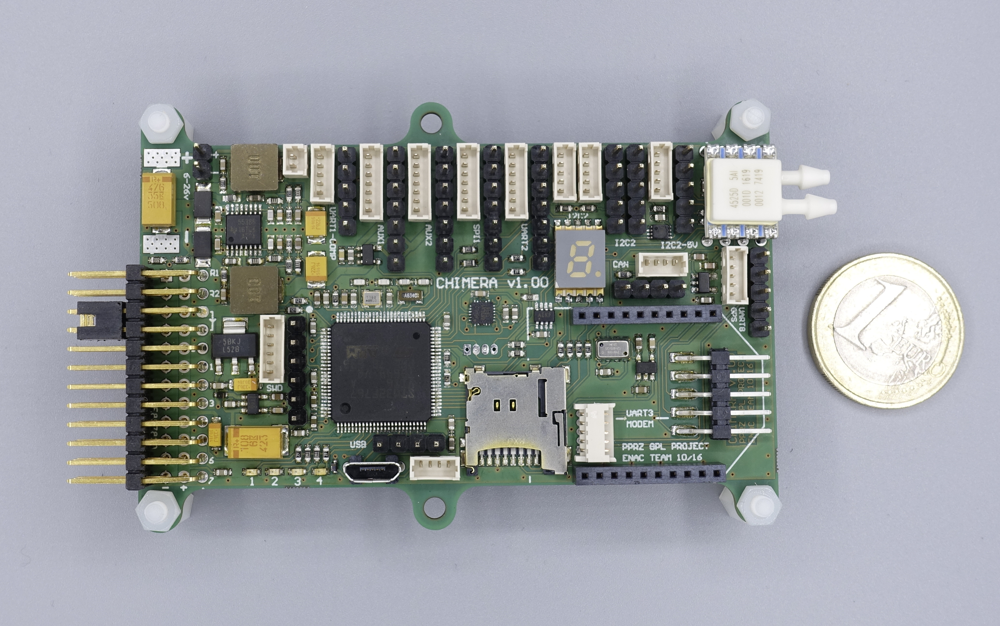
- 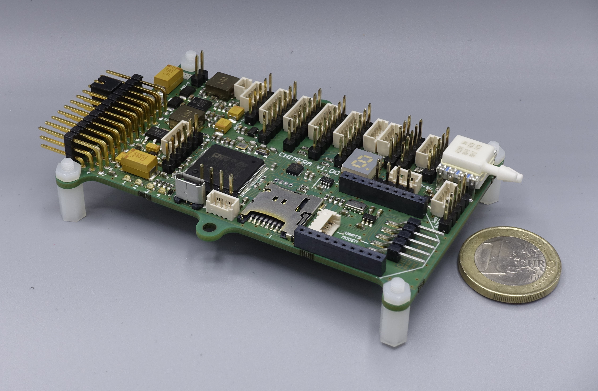
- 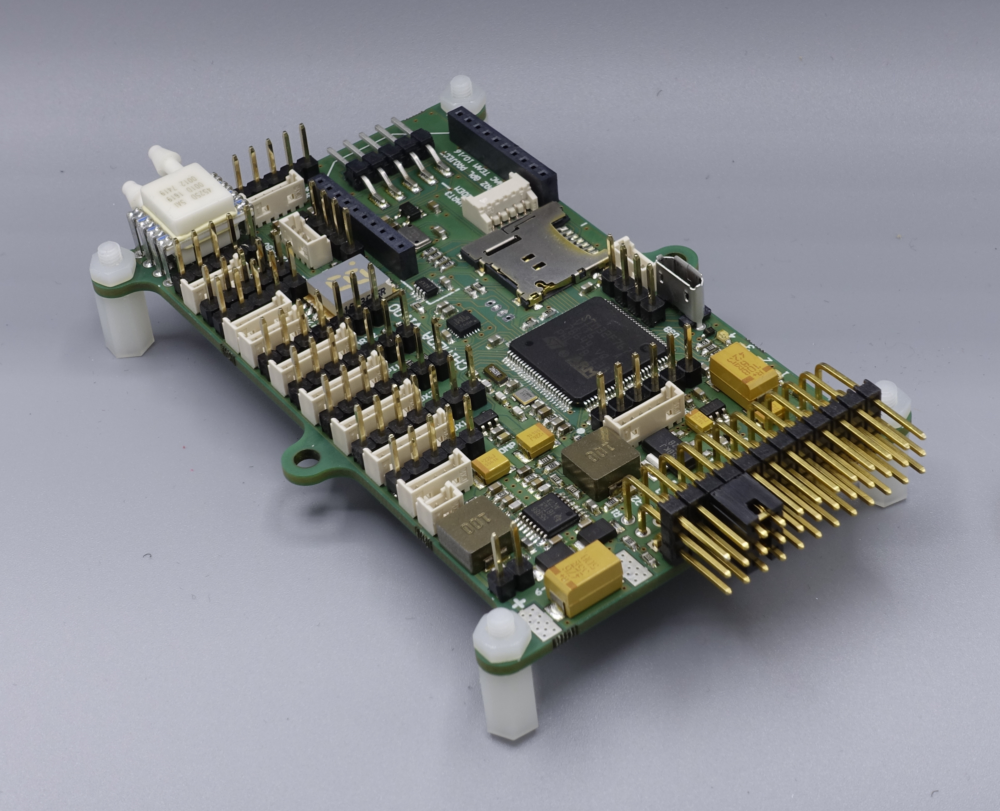
- 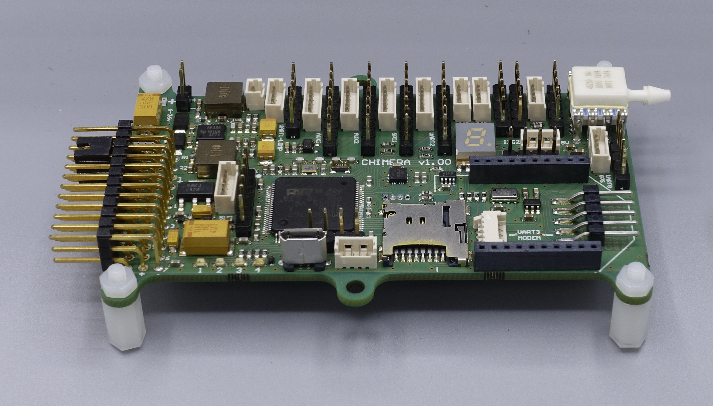
- 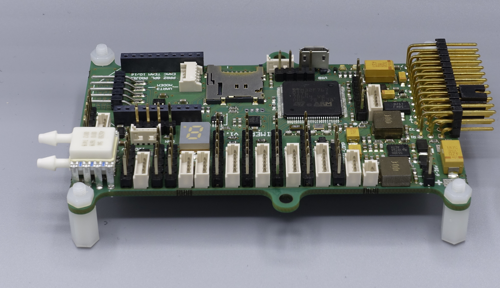
- 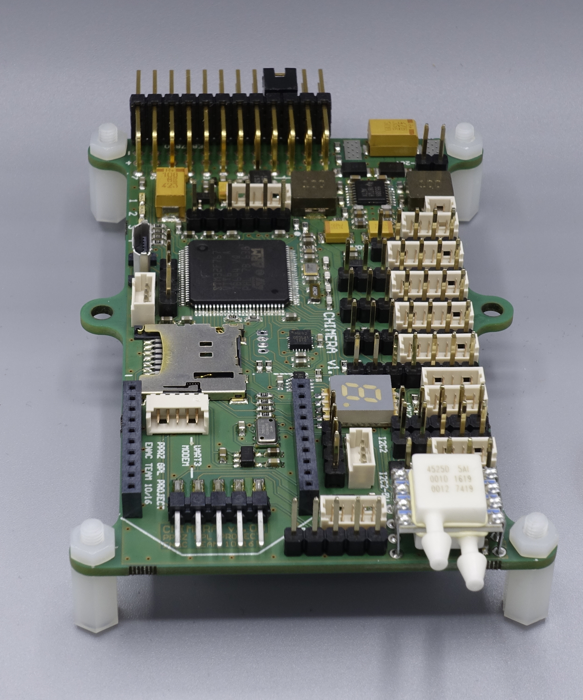
- 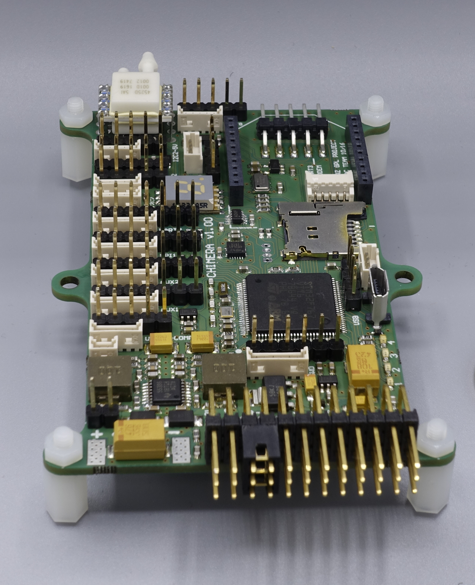
- 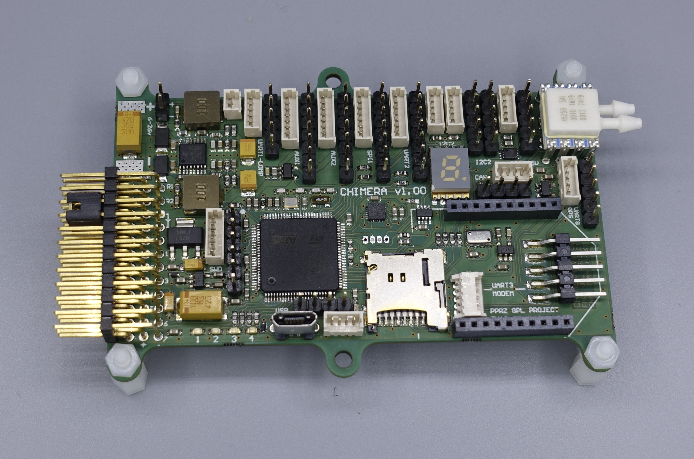
- 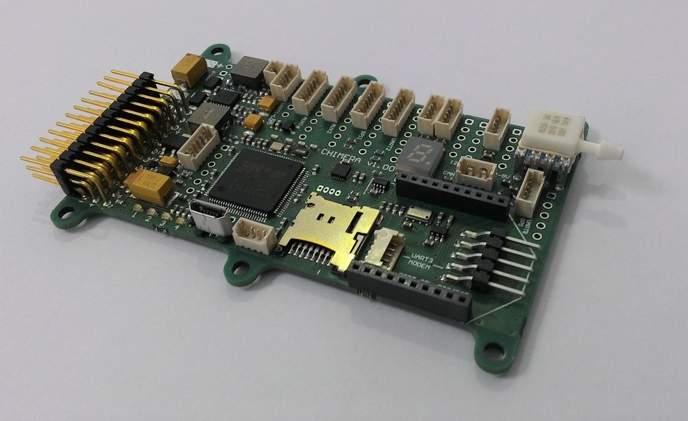
- 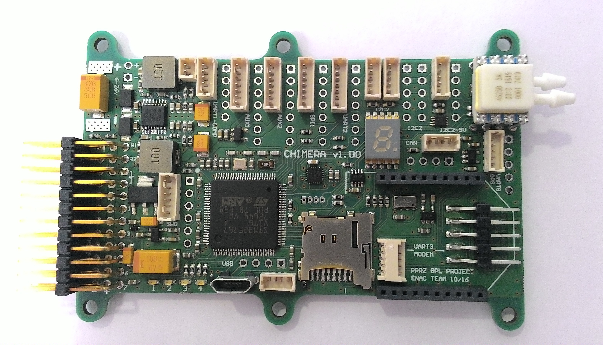

## Detailed Features

### MicroSD card (SDIO)

- software support available with **v5.2** and above
- hi-cap power designed to give enough time to cleanly save buffer and close file(s) when power outage detected
- USB-storage mode when plugging an USB cable after startup

### On-board Sensors

- 9 DOF IMU  
  [Invensense](http://www.invensense.com/) chip [MPU-9250](https://www.invensense.com/products/motion-tracking/9-axis/mpu-9250/) : 9 DOF, 3 axis Accelerometer + 3 axis Gyroscope + 3 axis Magnetometer
- Barometer/Altimeter  
  [TE Connectivity](http://www.te.com/) module [MS5611-01BA03](http://www.te.com/usa-en/product-CAT-BLPS0036.html) : High resolution Integrated digital pressure sensor, 10 to 1200 mbar, 24 bit ADC, I2C & SPI interface
- Differential pressure sensor / Pitot  
  [TE Connectivity](http://www.te.com/) transducer [MS4525DO-DS5AI001DP](http://www.te.com/usa-en/product-CAT-BLPS0002.html) : Digital Output Temperature and Differential Pressure sensor, Dual Sideport, 1PSI pressure range, I2C interface

### USB Modes

- USB plugged before autopilot is powered : enter DFU mode to be flashed  
  *New ! : Can be flashed even if autopilot is not powered.*
- USB plugged after autopilot is powered : stop ap task, enter usb storage mode to made sdcard content easily avalaible, after the host has mounted;copied;dismounted storage;unplugged usb, ap restart

### SWD: Serial Wire Debug

Permits flash and source level debugging via SWD part of cheap discovery card, or via more capable, fastest, more expensive probe like black magic probe or [CricketProbe](https://wiki.paparazziuav.org/wiki/CricketProbe/v1.00)

### R/C Serial

Chimera offer **two different R/C Receiver port** allowing direct connection (3 pin) of several brand off-the-shelf receivers **without hardware modification** or external encoder board:

- RC1: **PPM** (Timer2 or 5 / Ch2) or **S.BUS** (inverted UART4 Rx) or **Serial** (non-inverted UART4 Rx) or Serial **Spektrum satellite** (non-inverted UART4 Rx + GPIO for binding procedure)
- RC2: **S.BUS** (inverted UART7 Rx) or **Serial** (non-inverted UART7 Rx) or Serial **Spektrum satellite** (non-inverted UART4 Rx + GPIO for binding procedure)

*(see [R/C Receivers and Radios page](https://wiki.paparazziuav.org/wiki/RC_Receivers_and_Radios) for compatible receivers)*

### Power

The input power source (Battery) voltage range of Chimera is **6V to 26V** (2 to 6 Lipo cells)

- Twin Power Supply
  - one 5V/3A dedicated to Chimera, servos (see *Servo Power Supply selection* below) and other 5V peripheral
  - one 5V/3A dedicated to "Companion Computer" available on **UART1 connector** ("5V Comp.",#2) **can be switched ON and OFF** on demand using EN_COMP (MCU GPIO output PC04).
    - EN_COMP = 1 =\> 5V Comp. OFF
    - EN_COMP = 0 =\> 5V Comp. ON (default)

<!-- -->

- Servo Power Supply selection  
  Chimera offer 2 options for servo power supply
  - Onboard 5V, provided total current (autopilot + external 5V modules + servos) does not exceed 3A.
  - External 5V source (BEC) for special servo configuration

(see [*Servo Power options section*](https://wiki.paparazziuav.org/wiki/Chimera/v1.00#Servo_Power_options) below for more information)

- Power Switch  
  **5V** power output pin on **AUX A connector** ("5V Aux.",#2) **can be switched ON and OFF** on demand using APSW (MCU GPIO output PE06).
  - APSW = 0 =\> 5V Aux OFF
  - APSW = 1 =\> 5V Aux ON (default)

The internal switch TPS2051B is designed to withstand 500mA continuous current and is **short-circuit and thermally protected**.  
(see [TPS2051B](http://www.ti.com/product/tps2051b) datasheet for recommended operation conditions)

### Onboard Modem

Chimera offer two options for Modem:

- External Modem.  
  In this case, Modem should be plugged on "UART3" serial interface connector.
- Onboard XBee module.  
  In this case, XBee pins are connected to :
  - Dout -\> UART3 Rx (PD09)
  - Din -\> UART3 Tx (PD08)
  - Asso -\> GPIO (PA08)
  - Reset -\> GPIO (PE15)  
    *Note : do not use UART3 Rx and Tx signals if XBee plugged.*

### Companion Computer

Chimera allows to easily connect a "Companion Computer" (Raspberry Pi, BeagleBoneBlack, Intel Edison, Odroid, etc.) to perform on-board computationally intensive tasks impossible to achieve by the autopilot alone.  
This connection is made using "UART1" connector which offer:

- Dedicated 5V/3A supply (can be switched ON and OFF on demand using EN_COMP, GPIO output PC04)
- Serial interface UART1 Rx (PB07) & Tx (PB06) for fast communication

### Communication Buses

- UART/Serial  
  5 UART serial communication:
  - x1 with hardware flow control signals (UART 2)
  - x1 for GPS receiver (UART 8)
  - x1 (free if no) modem XBee (UART 3)
  - x1 (free if no) “Companion Computer” (UART 1)
  - x1 free on AUX B connector (UART 6)

<!-- -->

- I2C Bus  
  I2C2 interface (SDA2-PB11 and SCL2-PB10) is available in two voltage levels to allow connection of various types of external sensors:
  - 3.3V Logic ("I2C2 3V3" 2x 0.1" header and 2x Molex Picoblade connectors in //)
  - 5V Logic ("I2C2 5V" 1x 0.1" header and 1x Molex Picoblade connectors in //)

*Note: for testing purpose, I2C1 internal bus signals dedicated to IMU and IMU Slave I2C Bus dedicated to Barometer and Differential pressure sensor are available on 4 pads (or 4 pin MolexPicoblade connector if populated) next to the IMU.*

- SPI Bus  
  SPI1 interface (MOSI1-PB5 MISO1-PB4 SCK1-PB3 NSS1-PA15) is available on "SPI1" connector.  
  If more than one selection signal (NSS1) is needed, use auxiliary pins (AUX0 to AUX7) configured as GPIO output

<!-- -->

- CAN Bus

### LEDs & Display

- 4x Leds classical paparazzi state diplay
- 1x 7 segment (plus dot) Led digit for extended mode display

## Pinout

*Pins Name and Type are specified with respect to the Autopilot Board*

### General Pinout

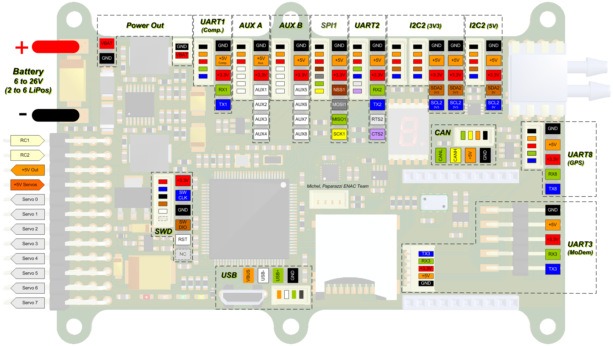  

**UART1 (Companion)**

| Pin # | Name | Type | MCU Port | Description |
| --- | --- | --- | --- | --- |
| 1 | <span class="pin-black-white">GND</span> | PWR | - | common ground |
| 2 | <span class="pin-orange-white">+5V Comp.</span> | PWR | Controlled by<br>PC5 | 5V/3A specific for Companion Computer<br>(PC5 = LOW =&gt; ON (default, pulldown) / PC5 = High =&gt; OFF) |
| 3 | <span class="pin-red-white">+3.3V</span> | PWR | - | 3.3V Rail from autopilot |
| 4 | <span class="pin-green-white">RX1</span> | IN | PB7 | UART1 Serial Input (3.3V level, 5V tolerant) |
| 5 | <span class="pin-blue-white">TX1</span> | OUT | PB6 | UART1 Serial Output (3.3V level) |

**UART2**

| Pin # | Name | Type | MCU Port | Description |
| --- | --- | --- | --- | --- |
| 1 | <span class="pin-black-white">GND</span> | PWR | - | common ground |
| 2 | <span class="pin-orange-white">+5V</span> | PWR | - | 5V Rail from autopilot |
| 3 | <span class="pin-red-white">+3.3V</span> | PWR | - | 3.3V Rail from autopilot |
| 4 | <span class="pin-green-white">RX2</span> | IN | PD6 | UART2 Serial Input (3.3V level, 5V tolerant) |
| 5 | <span class="pin-blue-white">TX2</span> | OUT | PD5 | UART2 Serial Output (3.3V level) |
| 6 | <span class="pin-grey-white">RTS2</span> | OUT | PD4 | UART2 Flow Control Request to Send (3.3V level) |
| 7 | <span class="pin-purple-white">CTS2</span> | IN | PD3 | UART2 Flow Control Clear to Send (3.3V level, 5V tolerant) |

**UART3 (Modem)**

| Pin # | Name | Type | MCU Port | Description |
| --- | --- | --- | --- | --- |
| 1 | <span class="pin-black-white">GND</span> | PWR | - | common ground |
| 2 | <span class="pin-orange-white">+5V</span> | PWR | - | 5V Rail from autopilot |
| 3 | <span class="pin-red-white">+3.3V</span> | PWR | - | 3.3V Rail from autopilot |
| 4 | <span class="pin-green-white">RX3</span> | IN | PD9 | UART3 Serial Input (3.3V level, 5V tolerant) DO NOT USE if XBee module present on Chimera |
| 5 | <span class="pin-blue-white">TX3</span> | OUT | PD8 | UART3 Serial Output (3.3V level) DO NOT USE if XBee module present on Chimera |

**UART8 (GPS Receiver)**

| Pin # | Name | Type | MCU Port | Description |
| --- | --- | --- | --- | --- |
| 1 | <span class="pin-black-white">GND</span> | PWR | - | common ground |
| 2 | <span class="pin-orange-white">+5V</span> | PWR | - | 5V Rail from autopilot |
| 3 | <span class="pin-red-white">+3.3V</span> | PWR | - | 3.3V Rail from autopilot |
| 4 | <span class="pin-green-white">RX8</span> | IN | PE0 | UART8 Serial Input (3.3V level, 5V tolerant) |
| 5 | <span class="pin-blue-white">TX8</span> | OUT | PE1 | UART8 Serial Output (3.3V level) |

**I2C2 (3V3)**

| Pin # | Name | Type | MCU Port | Description |
| --- | --- | --- | --- | --- |
| 1 | <span class="pin-black-white">GND</span> | PWR | - | common ground |
| 2 | <span class="pin-orange-white">+5V</span> | PWR | - | 5V Rail from autopilot |
| 3 | <span class="pin-red-white">+3.3V</span> | PWR | - | 3.3V Rail from autopilot |
| 4 | <span class="pin-sienna-white">SDA2</span> | Open Drain<br>I/O | PB11 | I2C2 bus Serial DAta ( 3.3V level , 1.5k pull-up) |
| 5 | <span class="pin-blue-white">SCL2</span> | Open Drain<br>I/O | PB10 | I2C12 bus Serial CLock ( 3.3V level , 1.5k pull-up) |

*Note: 2 x Molex Picoblade and 2 x 0.1" Header are all in parallel*  

**I2C2 (5V)**

| Pin # | Name | Type | MCU Port | Description |
| --- | --- | --- | --- | --- |
| 1 | <span class="pin-black-white">GND</span> | PWR | - | common ground |
| 2 | <span class="pin-orange-white">+5V</span> | PWR | - | 5V Rail from autopilot |
| 3 | <span class="pin-red-white">+3.3V</span> | PWR | - | 3.3V Rail from autopilot |
| 4 | <span class="pin-sienna-white">SDA2</span> | Open Drain<br>I/O | PB11 | I2C2 bus Serial DAta ( 5V level , 3.3k pull-up) |
| 5 | <span class="pin-blue-white">SCL2</span> | Open Drain<br>I/O | PB10 | I2C12 bus Serial CLock ( 5V level , 3.3k pull-up) |

**SPI1**

| Pin # | Name | Type | MCU Port | Description |
| --- | --- | --- | --- | --- |
| 1 | <span class="pin-black-white">GND</span> | PWR | - | common ground |
| 2 | <span class="pin-orange-white">+5V</span> | PWR | - | 5V Rail from autopilot |
| 3 | <span class="pin-red-white">+3.3V</span> | PWR | - | 3.3V Rail from autopilot |
| 4 | <span class="pin-sienna-white">NSS1</span> | OUT | PA15 | Slave Select. Selects the SPI slave |
| 5 | <span class="pin-grey-white">MOSI1</span> | I/O | PB5 | SPI1 Master Out Slave In. Data output from master / data input to slave |
| 6 | <span class="pin-green-white">MISO1</span> | I/O | PB4 | SPI1 Master In Slave Out. Data input to master / data output from slave |
| 7 | <span class="pin-yellow">SCK1</span> | I/O | PB3 | SPI1 Serial clock. Clock output from master or input to slave |

**AUX A ( paparazzi names )**

| Pin # | Name | Type | MCU Port | Description |
| --- | --- | --- | --- | --- |
| 1 | <span class="pin-black-white">GND</span> | PWR | - | common ground |
| 2 | <span class="pin-orange-white">+5V Aux</span> | PWR | Controlled by<br>PC4 | 5V from autopilot through Power Switch<br>(PC4 = LOW =&gt; OFF / PC4 = High =&gt; ON) |
| 3 | <span class="pin-red-white">+3.3V</span> | PWR | - | 3.3V Rail from autopilot |
| 4 | AUX1 | I/O | PA5 | General Purpose I/O (LED 5 , SPI SLAVE1 ) / ADC1+2 in5 ( ADC_1 ) / DAC2 / TIM2 ch1 |
| 5 | AUX2 | I/O | PA3 | General Purpose I/O (LED 6 , SPI SLAVE2 ) / ADC1+2+3 in3 ( ADC_2 ) / TIM2 ch4 / TIM5 ch4 / TIM9 ch2 |
| 6 | AUX3 | I/O | PA2 | General Purpose I/O (LED 7 , SPI SLAVE3 ) / ADC1+2+3 in2 ( ADC_3 ) / TIM2 ch3 / TIM5 ch3 / TIM9 ch1 |
| 7 | AUX4 | I/O | PA0 | General Purpose I/O (LED 8 , SPI SLAVE4 ) / ADC1+2+3 in0 ( ADC_4 ) / TIM2 ch1 ( PWM_INPUT1 ) / TIM5 ch1 |

**AUX B ( paparazzi names )**

| Pin # | Name | Type | MCU Port | Description |
| --- | --- | --- | --- | --- |
| 1 | <span class="pin-black-white">GND</span> | PWR | - | common ground |
| 2 | <span class="pin-orange-white">+5V</span> | PWR | - | 5V Rail from autopilot |
| 3 | <span class="pin-red-white">+3.3V</span> | PWR | - | 3.3V Rail from autopilot |
| 4 | AUX5 | I/O | PC3 | General Purpose I/O (LED 9 , SPI SLAVE5 ) / ADC1+2+3 in13 ( ADC_5 ) |
| 5 | AUX6 | I/O | PC2 | General Purpose I/O (LED 10 ) / ADC1+2+3 in12 ( ADC_6 ) |
| 6 | AUX7 | I/O | PC6 | General Purpose I/O (LED 11 ) / TIM3 ch1 / TIM8 ch1 / UART6 Tx |
| 7 | AUX8 | I/O | PC7 | General Purpose I/O (LED 12 ) / TIM3 ch2 / TIM8 ch2 ( PWM_INPUT2 ) / UART6 Rx |

**CAN**

| Pin # | Name | Type | MCU Port | Description |
| --- | --- | --- | --- | --- |
| 1 | <span class="pin-black-white">GND</span> | PWR | - | common ground |
| 2 | <span class="pin-orange-white">+5V</span> | PWR | - | 5V Rail from autopilot |
| 3 | <span class="pin-yellow">CANH</span> | I/O | - | CAN bidirectional + line |
| 4 | <span class="pin-green-white">CANL</span> | I/O | - | CAN bidirectional - line |

*Note: Embedded 120R terminator resistor.*  

**USB**

| Pin # | Name | Type | MCU Port | Description |
| --- | --- | --- | --- | --- |
| 1 | <span class="pin-black-white">GND</span> | PWR | - | common ground |
| 2 | <span class="pin-green-white">USB+</span> | I/O | PA12 | USB bidirectional D+ line |
| 3 | <span class="pin-white">USB-</span> | I/O | PA11 | USB bidirectional D- line |
| 4 | <span class="pin-orange-white">VBUS</span> | IN | PA9 | Indicates the presence of USB bus power (5V level), DFU or USB storage Mode selection (BOOT0 MCU pin) |

*Note: MicroUSB, Molex Picoblade and 0.1" Header USB connectors are in parallel, only one can be connected at a time.*  

**SWD (Serial Wire debug)**

| Pin # | Name | Type | MCU Port | Description |
| --- | --- | --- | --- | --- |
| 1 | <span class="pin-red-white">+3.3V</span> | PWR | - | 3.3V Rail from autopilot |
| 2 | <span class="pin-blue-white">SWCLK</span> | IN | PA14 | SWD Serial Clock |
| 3 | <span class="pin-black-white">GND</span> | PWR | - | common ground |
| 4 | <span class="pin-sienna-white">SWDIO</span> | I/O | PA13 | SWD Serial Data |
| 5 | RST | IN | NRST | MCU Reset |
| 6 | NC | - | - | Not connected, for STM ST-LINK/V2 connector compliance |

*Note: Pin to pin compatible with STM ST-LINK/V2 debug tool connector*  

**Power Out**

| Pin # | Name | Type | Description |
| --- | --- | --- | --- |
| 1 | <span class="pin-black-white">GND</span> | PWR | common ground<br>use only to power peripheral modules, DO NOT use as power supply input for autopilot |
| 2 | <span class="pin-red-white">VBAT</span> | PWR | + Rail from battery<br>use only to power peripheral modules, DO NOT use as power supply input for autopilot |

### R/C Receivers and Servos header pinout

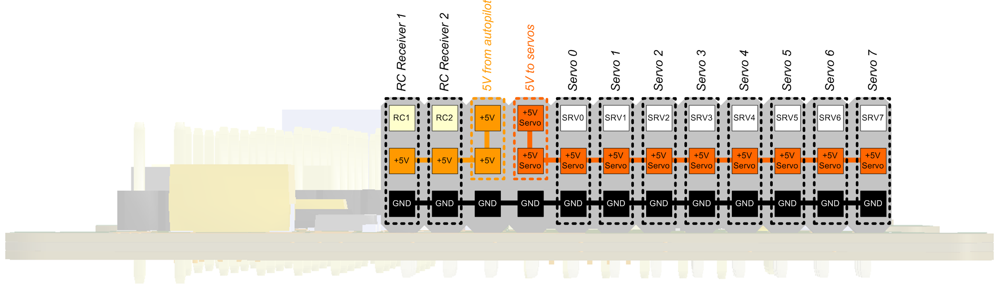  

**RC Receiver 1**

| Pin # | Name | Type | MCU Port | Description |
| --- | --- | --- | --- | --- |
| 1 | <span class="pin-black-white">GND</span> | PWR | - | common ground |
| 2 | <span class="pin-orange-white">+5V</span> | PWR | - | 5V Rail from autopilot |
| 3 | RC1 | I/O | PA1 | Serial (SBUS, Spektrum, etc.) or PPM Stream RC receiver signal (5V Tolerant)<br>UART4 Rx / TIM2 ch2 / TIM5 ch2<br>PPM, SPEKTRUM primary, SBUS secondary |

**RC Receiver 2**

| Pin # | Name | Type | MCU Port | Description |
| --- | --- | --- | --- | --- |
| 1 | <span class="pin-black-white">GND</span> | PWR | - | common ground |
| 2 | <span class="pin-orange-white">+5V</span> | PWR | - | 5V Rail from autopilot |
| 3 | RC2 | I/0 | PE7 | Serial (SBUS, Spektrum, etc.) RC receiver signal (5V Tolerant)<br>UART7 Rx<br>SBUS primary, SPEKTRUM secondary |

**Servo 0/1/2/3/4/5/6/7**

| Pin # | Name | Type | MCU Port | Description |
| --- | --- | --- | --- | --- |
| 1 | <span class="pin-black-white">GND</span> | PWR | - | common ground |
| 2 | <span class="pin-orangered-white">+5V Servo</span> | PWR | - | 5V Rail for Servos |
| 3 | SRV0<br>SRV1<br>SRV2<br>SRV3<br>SRV4<br>SRV5<br>SRV6<br>SRV7 | OUT | PA6<br>PA7<br>PB0<br>PB1<br>PD12<br>PD13<br>PD14<br>PD15 | Servo signal (PWM) |

### Servo Power options

There is two options to supply connected servos.  
*Note : Whatever option is chosen, autopilot's ground already connected to servomotor's ground.*  

#### Powering Servos with Autopilot

This option can be used provided total current from 5V rail (autopilot + external 5V modules + servos) does not exceed 3A.  
In this case, 5V servo rail must be connected to autopilot 5V rail as described below.  

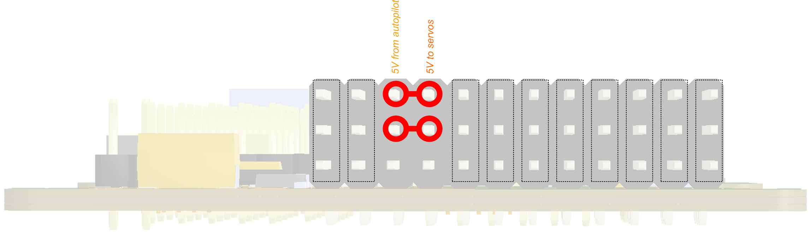  

***Warning**: make sure shunt current rating exceed servos total consumption*  
A practical way of making this connection is to use a 2 or 3 way shunt like Samtec's MNT-103-BK-G (3.9A/pin)

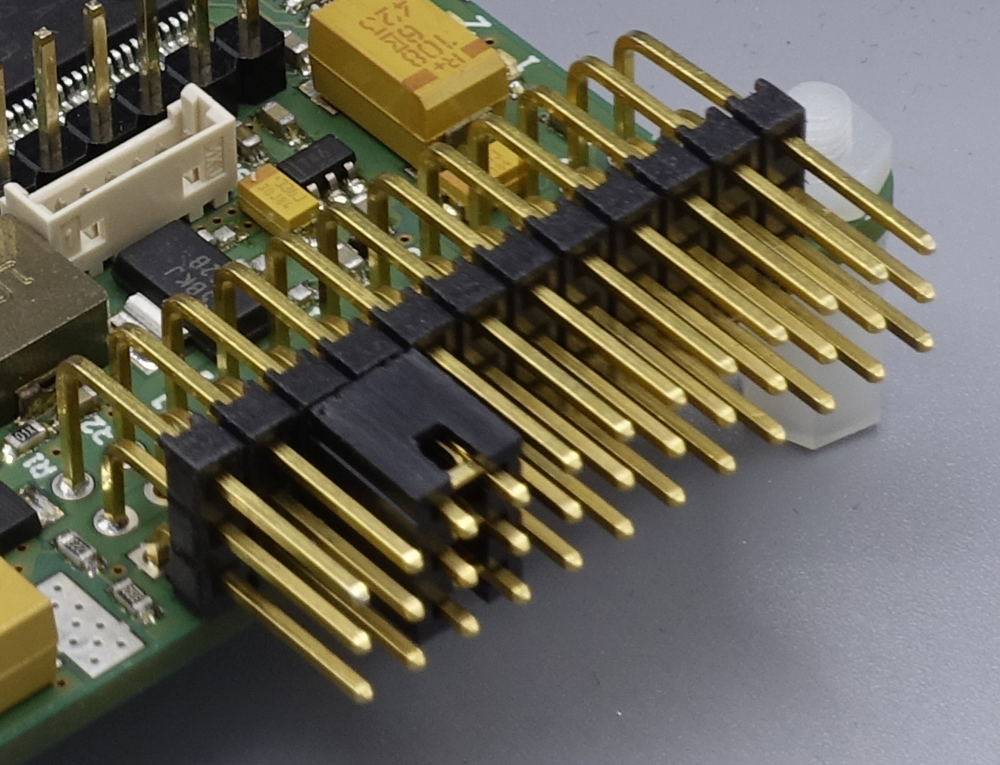 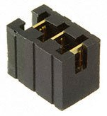  

#### Powering Servos using an external BEC/Power Source

This option must be used if total current from 5V rail may exceed 3A or for other special servo configuration.  

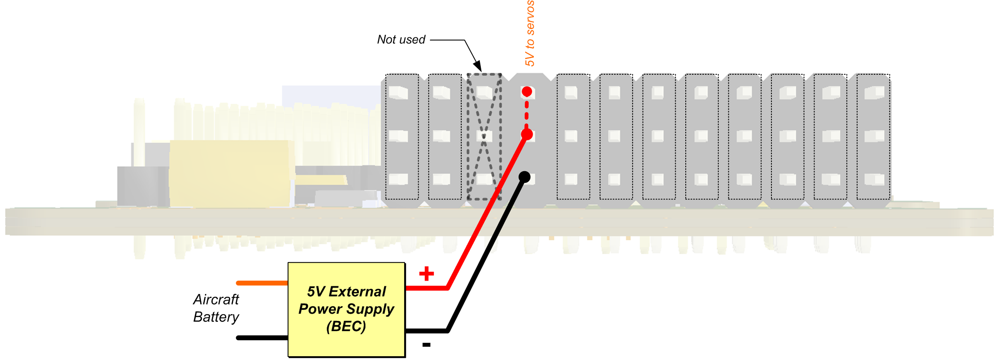  

## Schematic

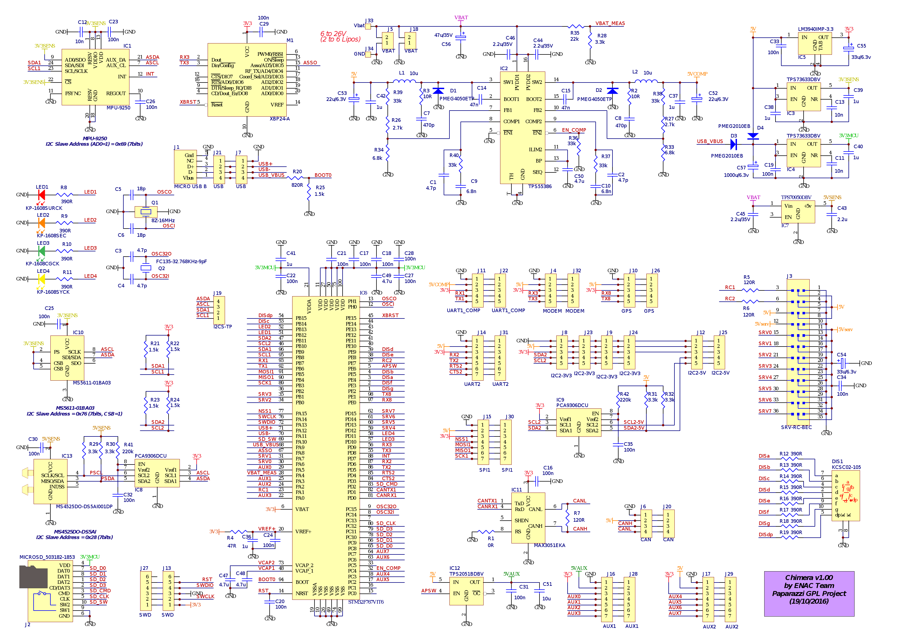

## Board production

### Gerber & Drill for PCB

PCB design [Eurocircuits 6-C class](http://www.eurocircuits.com/PCB-design-guidelines/#classification) compliant:

***[Download Chimera v1.00 PCB production files (zip)](downloads/chimera/Chimera_v100_gerber.zip)***

RS274X, units = Inches, format = 2:5

- Chimera_v100_Silkscreen_TOP.GBR (Top Component Print Layer)
- Chimera_v100_Soldermask_Top.GBR (Top Solder Mask)
- Chimera_v100_Paste_Mask_Top.GBR (Top Paste Mask, stencil)
- Chimera_v100_Signal_Top.GBR (Top Copper Layer)
- Chimera_v100_Internal_Plane_1.GBR (Internal Copper Layer GND)
- Chimera_v100_Internal_Plane_2.GBR (Internal Copper Layer +3.3V)
- Chimera_v100_Signal_Bottom.GBR (Bottom Copper Layer)
- Chimera_v100_Soldermask_Bottom.GBR (Bottom Solder Mask)
- Chimera_v100_Outline.GBR (Board Outline)
- Chimera_v100_Drill.GBR (NC XY coordinates & Drill tools sizes)

### Bill Of Material

***[Download Chimera v1.00 Bill of Material (zipped LibreOffice Calc & PDF file)](downloads/chimera/Chimera_v100_BoM.zip)***

### Components Layout

- 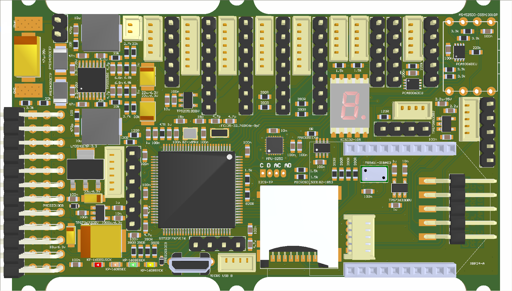

  Chimera v1.00 components Layout  
  (no Xbee modem & no differential pressure sensor)

- 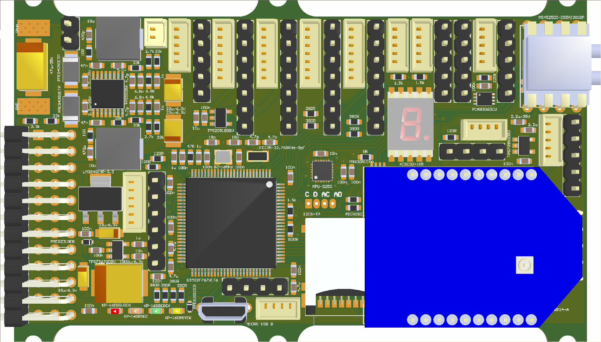

  Chimera v1.00 components Layout

- 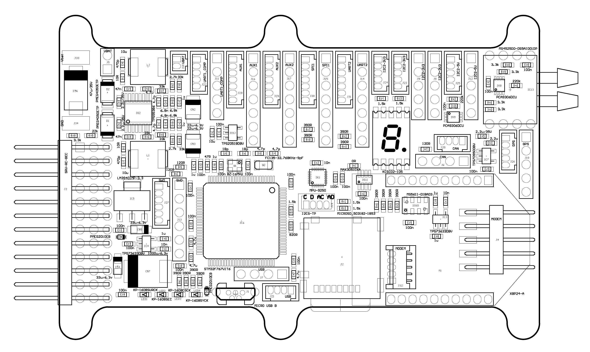

  Chimera v1.00 components detail

### Pick-and-Place

***[Download Chimera v1.00 Pick-and-Place files (zip)](downloads/chimera/Chimera_v100_pick_place.zip)***

- Chimera_v100_pick_place.csv
- Chimera_v100_pick_place.pik
- Chimera_v100_pick_place.txt

## Mechanical Dimensions

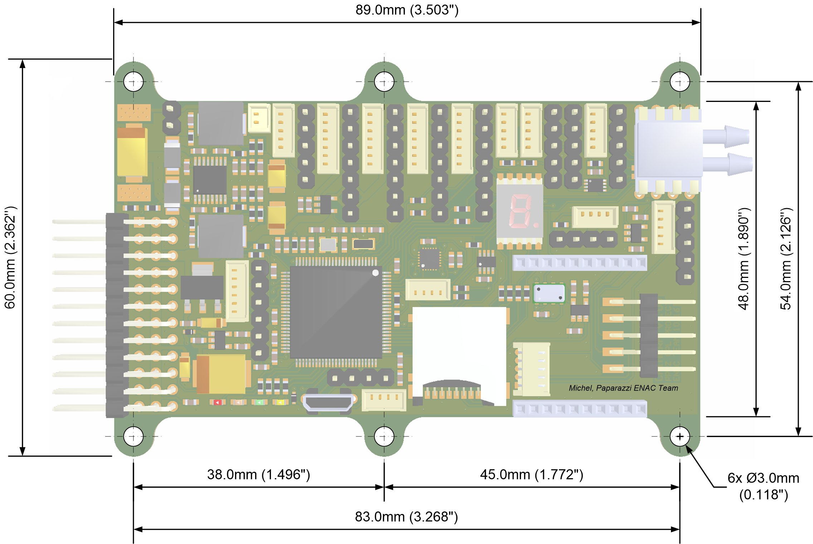  

## Programming

In order to compile airborne code for the STM32F7 line, it is required to have a GCC **5.4.x** or above. If not packaged by default in your distribution, you need to download and install it from <https://launchpad.net/gcc-arm-embedded>.

Chimera autopilot can reprogrammed in two different ways:

- Using the MCU native (embedded in rom) DFU USB bootloader over the on-board USB connectors (so pre-loading an "external" bootloader is useless)
  - required hardware : USB cable with USB-micro connector
  - required software : dfu_util tool (present in ubuntu repository)
- Using the SWD (Serial Wire Debug) connector
  - required hardware : SWD part of a cheap stm32 evaluation board (any discovery board, start @ 8\$), 2.54mm pitch pin-to-pin cable and USB cable with USB-mini or micro connector matching your evaluation board
  - required software : st_flash and st_util, have to be compiled from source (<https://github.com/texane/stlink>)

## On-board Data Logging

It is possible to write data on the embedded SD card from the main autopilot program. In order to cope with a real-time constraints of the autopilot, a light RTOS called [ChibiOS](https://www.chibios.org) is used to split the logging task from the rest of the system. Two modules are necessary to enable the logging system: the driver of the SD card system that also handle the file system (using FATFS) and a dynamic memory allocation system called TLSF. In order to enable this features for your Chimera board, you need to select the correct board type and add the required modules to the firmware section of your airframe file (logging is currently only available for **fixedwing** firmware):

```xml
<firmware name="firmware">
 ...
 <target name="ap" board="chimera_1.0">
   ...
 </target>
 ...
 <module name="tlsf"/>
 <module name="logger" type="sd_chibios"/>
</firmware>
```

This will active the automatic opening of a new log file (30 seconds) after each startup of the autopilot. Then you can freely write ASCII or binary data into this file (see a simple example logging for [meteorological data logging](https://github.com/paparazzi/paparazzi/blob/master/sw/airborne/modules/meteo/mf_ptu.c)). The file is **automatically** closed upon battery disconnection, no need to press any button to stop the logging.

To recover the data on the SD card, just power up the board **without** the USB plugged (otherwise it will enter in DFU boot mode), then plug the USB cable to the board and to your computer. This will stop the main autopilot program and will mount the SD card as a regular mass storage with a FAT file system. The log files are placed in a PPRZ folder. Unplugging the USB will reset the autopilot.

In addition to this, you can also load a [**flight recorder** module](http://docs.paparazziuav.org/latest/module__flight_recorder.html) (it also needs the **pprzlog** module for supporting the specific paparazzi binary log format).

```xml
<firmware>
 ...
 <module name="pprzlog"/>
 <module name="flight_recorder"/>
 ...
</firmware>
```

with the appropriate telemetry file (conf/telemetry/fixedwing_flight_recorder.xml). This will automatically open a second file where telemetry messages described in the FlightRecorder section of the telemetry file will be logged in [binary format](https://wiki.paparazziuav.org/wiki/Data_Logger#Storage_format). The files are store in a separated FR folder on the SD card. The decoding procedure is the same than [OpenLog](https://wiki.paparazziuav.org/wiki/Openlog#Decoding) and is using the **sd2log** tool:

    ~/paparazzi/sw/logalizer/sd2log [log_file] [optinal_output_dir]

This will produce 3 files: a *.log* and a *.data* files similar to the normal [ground station log](https://wiki.paparazziuav.org/wiki/Logs) and *.tlm* file that is a simple copy of the binary file (but rename with the same base name than the two others).

## Debugging

### Debugging with STM Discovery ST-LINK/V2 embedded debug tool

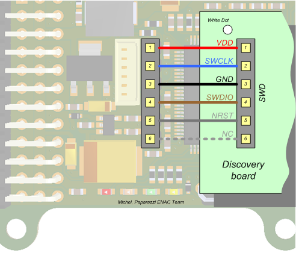

### Debugging with [CricketProbe](https://wiki.paparazziuav.org/wiki/CricketProbe/v1.00)

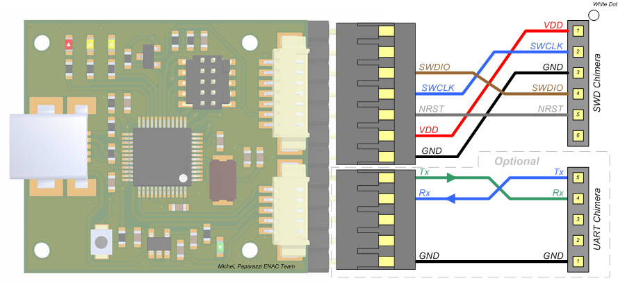

## Source code

Available in the [Paparazzi source repository](https://github.com/paparazzi/paparazzi/tree/master/sw/airborne/boards/chimera).

::::

## Attribution

Ported from [Chimera/v1.00](https://wiki.paparazziuav.org/wiki/Chimera/v1.00), wiki revision [24059](https://wiki.paparazziuav.org/w/index.php?oldid=24059) (2018-04-12). Contributors: Ghattenb, Michel, Alexandre. Illustrations and downloads are copied from the archived wiki uploads.
