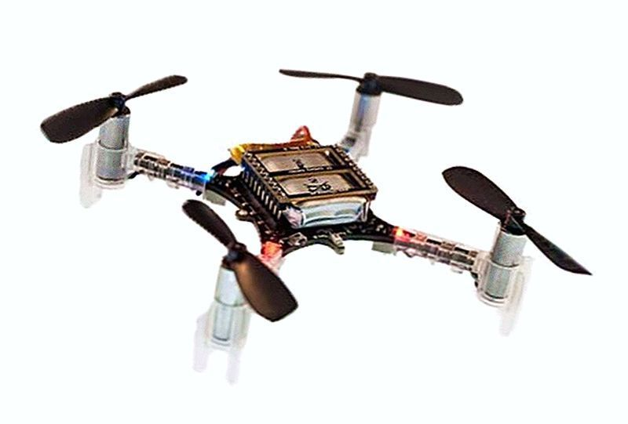

# Crazyflie 2.0

```{note}
The wiki page is titled Crazyflie 2.0, but its text and photograph describe Crazyflie 2.1. It mixes hardware generations: the IMU list includes a magnetometer, while a later section says one must be added. Specifications and firmware support need review before use.
```

## About

-



  Crazyflie 2.1

The Crazyflie 2.1 is nice little open source quadcopter. Yes it runs Paparazzi too. We had some testflights but we need more testflights, indeed.

## Features

- Easy to assemble and no soldering required
- WIP: Wireless firmware updates (not yet)
- On-board charging via standard uUSB
- Dual-MCU architecture with dedicated radio/power management SoC for advanced applications
- All the Real-time logging, graphing and variable setting as one is used to with Paparazzi

## Specifications

- Weight: 27g
- Size: 92x92x29mm
- Radio: BL 20 dBm nRF5182
- Bluetooth LE support

## Microcontrollers

- STM32F405 main application MCU (Cortex-M4, 168MHz, 192kb SRAM, 1Mb flash)
- nRF51822 radio and power management MCU (Cortex-M0, 32Mhz, 16kb SRAM, 128kb flash)
- uUSB connector
- On-board LiPo charger
- Full speed USB device interface
- 8KB EEPROM

## IMU

- 3 axis gyro (MPU-9250)
- 3 axis accelerometer (MPU-9250)
- 3 axis magnetometer (MPU-9250)
- High precision pressure sensor (LPS25H)

## Flight specifications

- Maximum payload weight: ~10 g

## Motors

There are four 7x16mm Coreless DC-motors icw default props that give a maximum take-off weight of ~40g

### Mechanical specification

- Diameter: 7.0 mm
- Length: 16.0 mm
- Shaft length: 3.5 mm
- Shaft diameter: 0.8 mm
- Weight: 2.7 g
- Wire length: 32.0 mm

### Electrical specification

- Kv: 14 000 rpm/V
- Rated voltage: 4.2 V
- Rated current: 1000mA

## Expansion connectors

- VCC (3.0V, max 100mA)
- GND
- VCOM (unregulated VBAT or VUSB, max 1A)
- VUSB (both for input and output)
- I2C (400kHz)
- SPI
- 2 x UART
- 4 x GPIO/CS for SPI
- 1-wire bus for expansion identification
- 2 x GPIO connected to nRF51

## Airframe

The archived wiki page provides no airframe example.

## Flashing

### Flashing via DFU

Howto set the Crazyflie in the DFU update mode:

1.  Connect the USB cable to your Crazyflie 2.1 but not to your PC just yet...
2.  Unplug the Crazyflie 2.1 battery if it is plugged in
3.  Keep pressing the on/off button while inserting the USB cable in your PC
4.  Hold down the button for about 5 seconds until if starts to blink faster second blink rate (1Hz), then release the on/off button
5.  The Crazyflie 2.1 can now receive your new firmware... Click "Upload" in Paparazzi Centre

### Flashing via BlackMagicProbe

For this you need a BMP and a 10 pin adaptor board.

### Over Air

Over the air updates via the nordic chip are not yet possible, feel free to help us out and make it happen.

## Debugging

With the BlackMagicProbe JTAG adapter development can be smoother than without. A worthy investment if you value speed development.

## Extra

### Add GNSS

A light GPS can be added to e.g. the I2C bus, for example the uBlox CAM-M8Q

### Add Magnetometer

The previous iteration had an magnetometer, well now you best add one over I2C bus

### Wifi

One can add one of those [small EP8266 based Wifi modules described here](https://github.com/paparazzi/esp8266_udp_firmware) to have telemetry via WiFi in a simple way

## Links

Links with al sorts of no PPRZ information that my come in handy:

- <https://wiki.bitcraze.io/projects:crazyflie2:index>
- <https://github.com/bitcraze/crazyflie-firmware/tree/crazyflie2>
- <https://wiki.bitcraze.io/projects:crazyflie:hardware:explained>

## Attribution

Imported from [Crazyflie 2.0](https://wiki.paparazziuav.org/wiki/Crazyflie_2.0), wiki revision [25218](https://wiki.paparazziuav.org/w/index.php?oldid=25218) (2020-11-05). Contributors: Openuas. Images copied from the local wiki archive.
