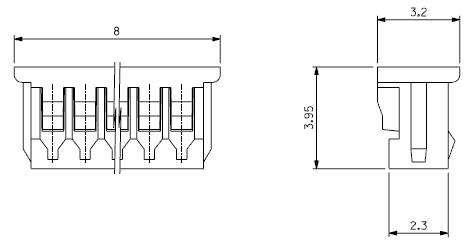
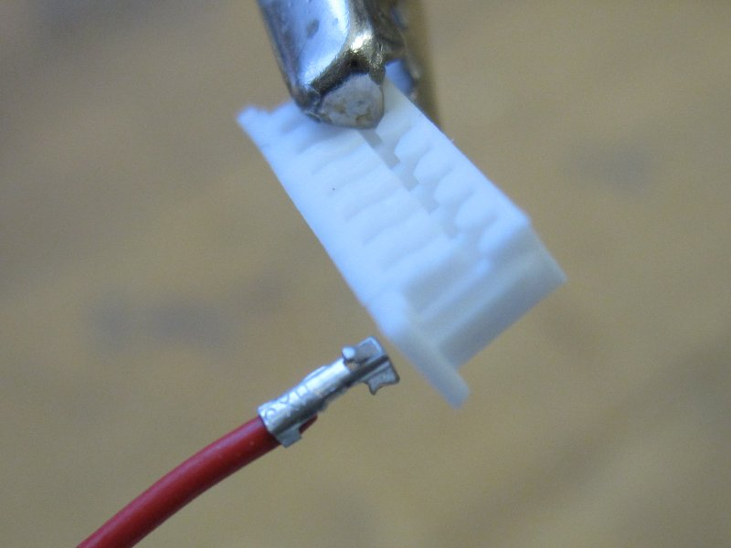
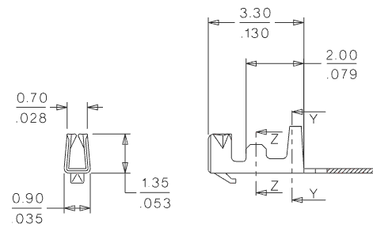
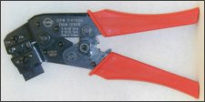

# Molex PicoBlade connectors

1.25 mm (0.049 inch) pitch connector system.

```{note}
Imported from the archived wiki revision dated 2016-01-07. Supplier links, prices, and availability reflect that revision and have not been revalidated. Check the connector specified for your board.
```

 Molex plug

Paparazzi autopilots use [1.25mm Molex PicoBlade™](http://www.molex.com/cgi-bin/bv/molex/jsp/family/intro.jsp?BV_SessionID=@@@@1727607529.1210263742@@@@&BV_EngineID=cccdadedmmeeehecflgcehedffgdfmk.0&oid=-10261&channel=Products&familyOID=-10261&frellink=Introduction&chanName=family&pageTitle=PicoBlade�%20%7C%20Overview) headers for all connections. Users must make their own wiring harnesses by either crimping the molex terminal pins onto their wiring or soldering pre-crimped wires to their peripherals.

- Be sure to order plenty of 1.25mm Molex plugs (the linked datasheet is unavailable in the archive) (female)
- Current: 1.0A
- Wires are available (post sources) with pins already crimped - simply trim and solder these to your peripherals and assemble them into the Molex plugs. Try [Farnell](http://www.farnell.com/) Part number 112-5276 or 112-5274, RS-Components [279-9516](http://uk.rs-online.com/web/search/searchBrowseAction.html?method=searchProducts&searchTerm=279-9516&x=0&y=0) or [279-9544](http://uk.rs-online.com/web/search/searchBrowseAction.html?method=searchProducts&searchTerm=279-9544&x=30&y=20). In the US Newark has them. Part number [93K4876](http://www.newark.com/jsp/search/productdetail.jsp?sku=93K4876) ~\$10 for 10 300mm wires with a socket on each end.

## 1.25mm (0.049") Pitch PicoBlade Receptacle (Female)

 Inserting a Molex crimp

These are the connector housings, used in the wiring harness and not the PCB

- [51021-0200](http://www.mouser.com/search/ProductDetail.aspx?R=51021-0200virtualkey53810000virtualkey538-51021-0200) 1.25mm Molex PicoBlade Receptacle 2pos
- [51021-0300](http://www.mouser.com/search/ProductDetail.aspx?R=51021-0300virtualkey53810000virtualkey538-51021-0300) 1.25mm Molex PicoBlade Receptacle 3pos
- [51021-0400](http://www.mouser.com/Search/ProductDetail.aspx?qs=ILqg114nvd6Z%252bmZXFEtu8g%3d%3d) 1.25mm Molex PicoBlade Receptacle 4pos
- [51021-0500](http://www.mouser.com/search/ProductDetail.aspx?R=51021-0500virtualkey53810000virtualkey538-51021-0500) 1.25mm Molex PicoBlade Receptacle 5pos
- [51021-0700](http://www.mouser.com/Search/ProductDetail.aspx?qs=hSmm4fxMIuNmj4UzNb1XZA%3d%3d) 1.25mm Molex PicoBlade Receptacle 7pos
- [51021-0800](http://www.mouser.com/search/ProductDetail.aspx?R=51021-0800virtualkey53810000virtualkey538-51021-0800) 1.25mm Molex PicoBlade Receptacle 8pos
- [51021-1000](http://www.mouser.com/search/ProductDetail.aspx?R=51021-1000virtualkey53810000virtualkey538-51021-1000) 1.25mm Molex PicoBlade Receptacle 10pos

## 1.25mm (0.049") Female Crimp Terminals

The 1.25mm terminals are extremely small and *cannot and should not be soldered, crimped with pliers, or attached by any tool other than the genuine Molex crimper.* Remember that if a wire comes loose, any wire, the plane will crash!

- [Mouser 50058-8000](http://www.mouser.com/search/ProductDetail.aspx?R=50058-8000virtualkey53810000virtualkey538-50058-8000) 28-32 tape (\$0.04-0.07 USD based on qty)
- [Mouser 50079-8000](http://www.mouser.com/search/ProductDetail.aspx?R=50079-8000virtualkey53810000virtualkey538-50079-8000) 26-28 tape (\$0.03-0.07 USD based on qty)

or

- [Digi-Key WM1142CT-ND](http://search.digikey.com/scripts/DkSearch/dksus.dll?Detail&name=WM1142CT-ND) 26-28 AWG
- [Digi-Key WM1775-ND](http://search.digikey.com/scripts/DkSearch/dksus.dll?Detail&name=WM1775-ND) 28-32 AWG

 Molex pin

## Crimpers

 Molex Crimper

Crimpers are available from Mouser or Digi-Key for approximately \$200 USD and will prove worthwhile for most users. The fact that Wire-to-Wire Plugs are available should make this Crimper an even more worthwhile investment.

- Strip Length should be between 1.40 to 1.90mm
- Wire Insulation Range should be \< 1.0mm with the 28-32AWG Terminals and \< 1.04mm with the 26-28AWG Terminals

<!-- -->

- [Digi-Key WM9984-ND](http://search.digikey.com/scripts/DkSearch/dksus.dll?Detail&name=WM9984-ND) for 26-32 AWG wire
- [P/N# 63811-0300](http://www.mouser.com/search/refine.aspx?Ntt=63811-0300) for 28-26 AWG wire (obsolete)
- [P/N# 63811-0200](http://www.mouser.com/search/refine.aspx?Ntt=63811-0200) for 32-28 AWG wire (obsolete)

## 1.25mm (0.049") Pitch PicoBlade Plug (Male, Wire-to-wire)

These Plugs are for Wire-to-Wire connections and they are not required. Their reference here is for convenience only.

- [51047-0200](http://www.mouser.com/search/ProductDetail.aspx?R=51047-0200virtualkey53810000virtualkey538-51047-0200) 1.25mm Molex PicoBlade Plug 2pos
- [51047-0300](http://www.mouser.com/search/ProductDetail.aspx?R=51047-0300virtualkey53810000virtualkey538-51047-0300) 1.25mm Molex PicoBlade Plug 3pos
- [51047-0400](http://www.mouser.com/search/ProductDetail.aspx?R=51047-0400virtualkey53810000virtualkey538-51047-0400) 1.25mm Molex PicoBlade Plug 4pos
- [51047-0500](http://www.mouser.com/search/ProductDetail.aspx?R=51047-0500virtualkey53810000virtualkey538-51047-0500) 1.25mm Molex PicoBlade Plug 5pos
- [51047-0600](http://www.mouser.com/search/ProductDetail.aspx?R=51047-0600virtualkey53810000virtualkey538-51047-0600) 1.25mm Molex PicoBlade Plug 6pos
- [51047-0700](http://www.mouser.com/search/ProductDetail.aspx?R=51047-0700virtualkey53810000virtualkey538-51047-0700) 1.25mm Molex PicoBlade Plug 7pos
- [51047-0800](http://www.mouser.com/search/ProductDetail.aspx?R=51047-0800virtualkey53810000virtualkey538-51047-0800) 1.25mm Molex PicoBlade Plug 8pos
- [51047-0900](http://www.mouser.com/search/ProductDetail.aspx?R=51047-0900virtualkey53810000virtualkey538-51047-0900) 1.25mm Molex PicoBlade Plug 9pos
- [51047-1000](http://www.mouser.com/search/ProductDetail.aspx?R=51047-1000virtualkey53810000virtualkey538-51047-1000) 1.25mm Molex PicoBlade Plug 10pos

## 1.25mm (0.049") Male Crimp Terminals

These Crimp Terminals are for Wire-to-Wire connections and they are not required. Their reference here is for convenience only.

- [50133-8000](http://www.mouser.com/search/ProductDetail.aspx?R=50133-8000virtualkey53810000virtualkey538-50133-8000) 28-32 tape
- [50125-8000](http://www.mouser.com/search/ProductDetail.aspx?R=50125-8000virtualkey53810000virtualkey538-50125-8000) 26-28 tape

  

## Pre-Crimped Connectors from eBay China (Molex Picoblade)

(These are the standard Molex Picoblade connector)

You can find 10pcs female crimp terminals with 10cm wire and and 10 male terminals in a bundle for around 5€ Search for: "mini/micro jst 10pcs"

This is very nice if you do not have a crimp tool and want the cheapest connectors with wires on the market. Note: the male terminals in 1.25mm pitch and are trough hole technology Be careful, most SMD male terminals are 1mm pitch and can't be used on the [Lisa/M](https://wiki.paparazziuav.org/wiki/Lisa/M) which has 1.25mm pitch.

## Attribution

Imported only the PicoBlade section of [Connectors and Wiring](https://wiki.paparazziuav.org/wiki/Connectors_and_Wiring), wiki revision [20723](https://wiki.paparazziuav.org/w/index.php?oldid=20723) (2016-01-07). Contributors: Martinmm, Michel, Esden, Aerovista, NeoFromMatrix, IHaveADrone, AutumnLeaves. Images copied from the local wiki archive. The original datasheet link points to a missing wiki upload and is omitted.
