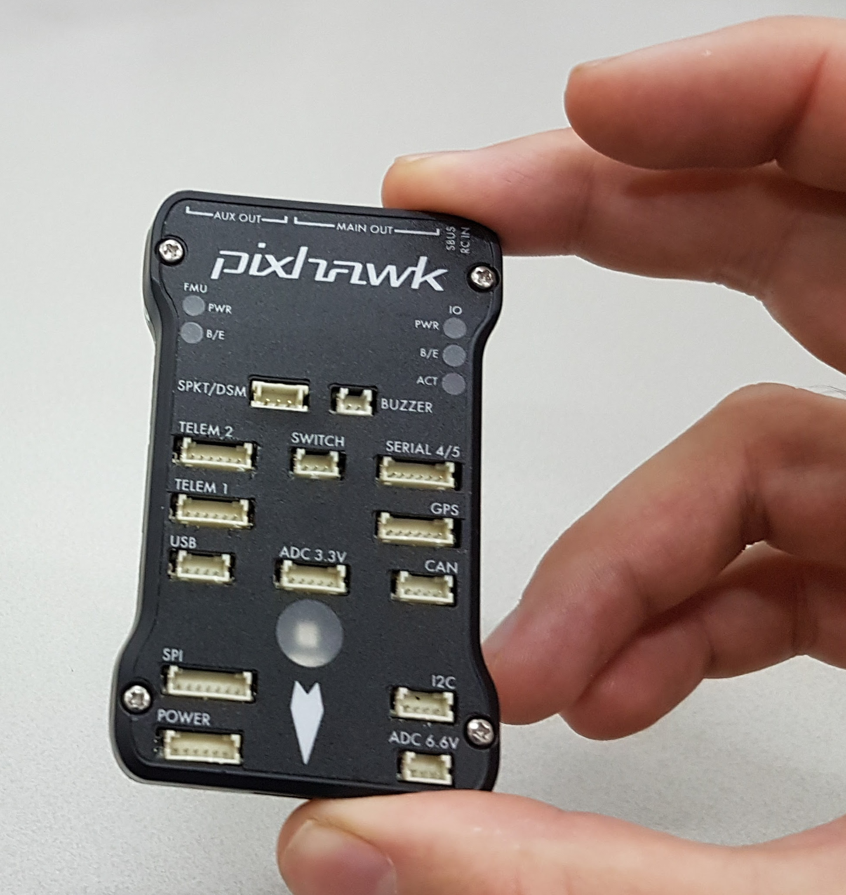
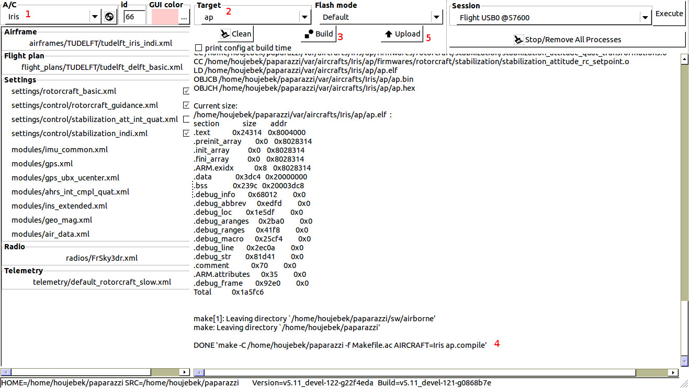
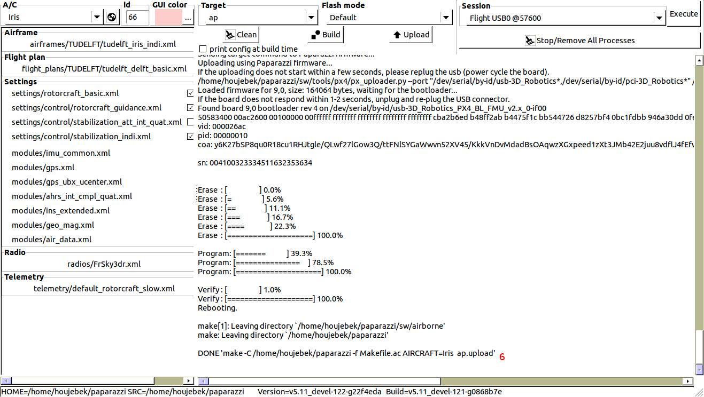
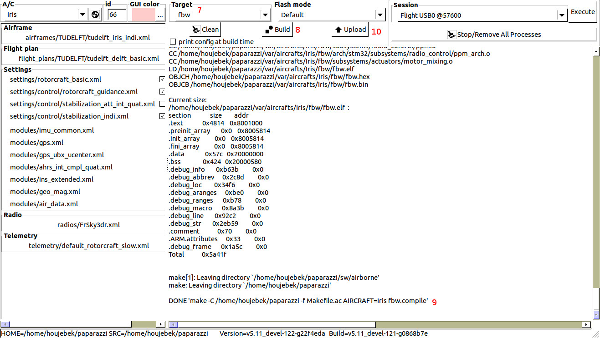
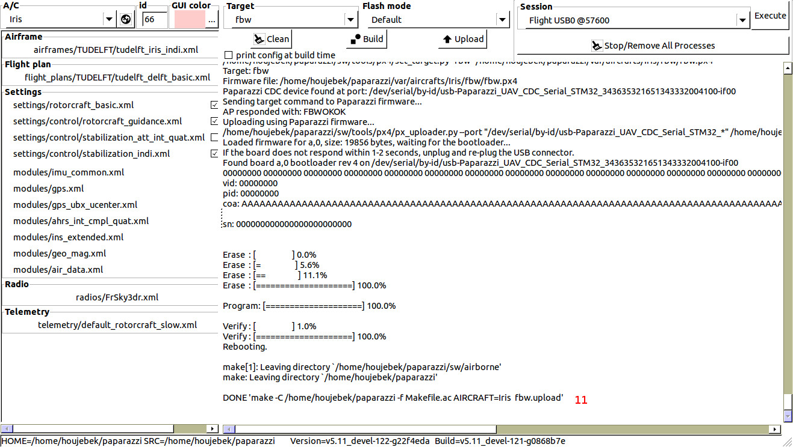
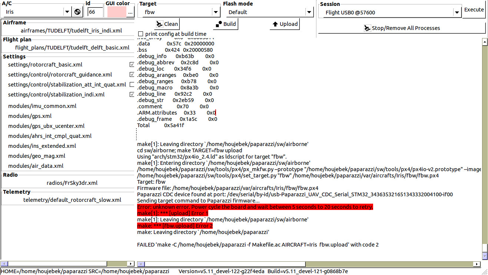

# Pixhawk 1

```{note}
This archived guide covers the original Pixhawk 1 (PX4FMU/PX4IO). Configuration examples, flashing timings, and feature support reflect the wiki revision below and have not been revalidated.
```

 Pixhawk 1 v2.4

## Paparazzi on Pixhawk

The Pixhawk is an open hardware autopilot that was originally developed by ETHZ in the [PIXHAWK project](https://pixhawk.ethz.ch/). Paparazzi now supports the Pixhawk and the firmware can be uploaded through the orignal PX4 custom bootloader, which happens directly through the USB port of the Pixhawk. This means that it is possible to easily switch between the Paparazzi AP and other projects that support the Pixhawk hardware (i.e. PX4 and APM).

It is also possible to directly upload to the Pixhawk by means of the JTAG port, but this is not recommended as it involves soldering and permanently removes the PX4 bootloader (which means reverting to PX4 or APM firmware is complicated). Therefor, this wiki focuses on flashing through the PX4 bootloader.

An step-by-step example on flying Paparazzi with a Pixhawk can be found on the [Iris](https://wiki.paparazziuav.org/wiki/Iris) page.

## Intro

This page is intended as a guide on how to get the Paparazzi autopilot running on a Pixhawk board. For the specifications and pin-out details we recommend to look at the [Pixhawk site](https://pixhawk.org/modules/pixhawk). Details on how to flash the board with Paparazzi can be found [below](#flashing). A complete step by step example on how to get a drone flying with Paparazzi + Pixhawk is provided with the [Iris](https://wiki.paparazziuav.org/wiki/Iris) drone. A list of features that are currently (not) supported in Paparazzi can be found [here](#features).

The Pixhawk consists of the PX4IO (designed around a stm32f1) and the PX4FMU (designed around a stm32f4), which are glued together in one pcb. Uploading of the autopilot (which runs only on the PX4FMU) happens directly from computer over USB to the PX4FMU, by means of the PX4 bootloader. In the original PX4 and APM Pixhawk software, the compiled PX4IO code (which runs the Fly By Wire) is embedded with the PX4FMU code, and the PX4FMU code would flash the PX4IO board at startup. But, in Paparazzi, the PX4IO is flashed from the computer --\> USB -\> PX4FMU --\> internal UART --\> PX4IO, directly from Paparazzi Center. This means PX4IO board can be flashed without changing the autopilot, and vice versa.

## Getting started

In short, the steps you'll need to run through are roughly the following:

- 1\. Define your aircraft and settings for the Pixhawk (e.g. see the [Iris airframe](https://github.com/paparazzi/paparazzi/blob/master/conf/airframes/tudelft/iris_indi.xml) )
- 2\. Connect the Pixhawk via USB to your computer, and upload the AP firmware
- 3\. Replug the USB, and upload the FBW code. Replug USB again.

Details on steps 2 and 3 can be found in [Flashing](#flashing). Details on step 1 can be found [further below](#airframe-config).

## Flashing

 Figure 2; building the AP

 Figure 3; flashing the AP

 Figure 4; building the FBW

 Figure 5; flashing the FBW

In order to flash the Pixhawk, both the AP (AutoPilot on the PX4FMU) and the FBW (Fly By Wire on the PX4IO) have to be flashed. Paparazzi uses the default PX4 bootloader to upload and flash the code in both systems, but the FBW is flashed through the AP. This means that at least for the first time, the AP has to be flashed with Paparazzi first.

- To flash the AP (See figure 2 and 3):
  - Select your aircraft (1).
  - Select the AP (2).
  - Click the build button (3).
  - After the compilation was completed successfully (4), plug in the USB cable to computer and the Pixhawk.
  - After 5 seconds click upload (5).
  - You should see "upload successful" (6).

<!-- -->

- To flash the FBW (See figure 4 and 5):
  - Select FBW (7).
  - Click the build button (8).
  - After the compilation was completed successfully (9), plug in the USB cable to computer and the Pixhawk.
  - Between 10 to 20 seconds after replugging, click upload (10).
  - You should see "upload successful" (11).

Notes:

- After flashing the FBW, it is required to re-power the Pixhawk.
- The flashing of the FBW is disabled 20 seconds after power up. Re-power to reset the time.
- If the Pixhawk is in view, one can monitor the system (B/E) led of the autopilot (left, FMU side). After 10 seconds, the system led will blink slower, meaning the autopilot has booted and the FBW can be flashed. After 20 second, the system led will blink slow (1Hz), meaning the FBW cannot be flashed any more.
- Whether the current code is APM, PX4 or Paparazzi, the flashing steps remain the same.

Issues:

- In case of problems such as in figure 6, most of the time it can be solved by re-powering the Pixhawk (e.g. re-plugging the USB, and removing the battery), wait for 10 seconds for the computer to recognize the USB device, and click the upload button again.
- Users reported swapping USB cables fixed their upload issues

 Figure 6; upload problems

## Airframe config

In order to fly a drone with the Pixhawk system in paparazzi, some Pixhawk specific configuration is required.

- Define seperate \<firmware\>'s for both the fbw and the ap:

**File: conf/airframes/<yourairframe>.xml**

```xml
<target name="ap" board="px4fmu_2.4" />
```

And:

**File: conf/airframes/<yourairframe>.xml**

```xml
<target name="fbw" board="px4io_2.4" />
```

  

- Configure the interMCU communication to use UART 6 at the AP:

**File: conf/airframes/<yourairframe>.xml**

```xml
<module name="intermcu" type="uart">
   <configure name="INTERMCU_PORT" value="UART6" />
   <configure name="INTERMCU_BAUD" value="B1500000" /> <!-- This is only during first 10s start up, afterwards it is set to 230400-->
</module>
```

And at the FBW:

**File: conf/airframes/<yourairframe>.xml**

```xml
    <define name="INTERMCU_LOST_CNT" value="100" />
    <module name="intermcu" type="uart">
      <configure name="INTERMCU_PORT" value="UART2" />
      <configure name="INTERMCU_BAUD" value="B1500000" />
    </module>
```

Configuration of the baud at 1500000 is strongly recommended, as this will remain backwards compatible with the PX4 code and bootloader. However, in Paparazzi the baud rate is slowed down to 230400 10s after start up, as the Pixhawk hardware actually does not seem to support flawless data transfers at those speeds. At least not in Paparazzi.

- Define the IMU to be:

**File: conf/airframes/<yourairframe>.xml**

```xml
<module name="imu" type="px4fmu_v2.4"/>
```

Which uses the l3gd20 gyro and the lsm303d accelero. The Pixhawk has two IMU's, so alternatively you can also use the MPU6000 IMU:

**File: conf/airframes/<yourairframe>.xml**

```xml
<module name="imu" type="mpu6000"/>
```

- Add the px4_flash module:

**File: conf/airframes/<yourairframe>.xml**

```xml
<modules main_freq="512">
  <module name="px4_flash">
    <configure name="PX4IO_UART" value="uart6"/>
  </module>
    ...
```

This enables uploading through the PX4 bootloading and activates the usb-serial device after startup.

## Features

The features that are currently supported by Paparazzi are the following:

- The dual processor setup (main stm32f4 and co stm32f1 processor), in a AP (AutoPilot) + FBW (Fly By Wire)
- Dual IMU (selectable from airframe config)
  - MPU6000, 3axis acc + gyro + magneto
  - LSM303 3-axis acc + magneto, L3G 3-axis gyro
- External GPS + Magneto
- 8+6 pwm outputs (8 on FBW, 6 on AP)
- Arm button led denotes mode info
- Spektrum RC, including binding through software
- PPM RC

The features that are not yet supported by Paparazzi are the following:

- The multicolor LED
- The buzzer
- The on-board arm button
- The SD card SDIO
- RC downlink (e.g. gps info, battery info)

## Videos

Paparazzi UAV Pixhawk tutorial videos - by the [TU Delft MAVLab](http://mavlab.lr.tudelft.nl/)  

  

[Pixhawk tutorial video playlist](https://www.youtube.com/playlist?list=PL_KSX9GOn2P-CVsy-lRSHAnUwVF9wI_pZ)

## Attribution

Imported from [Pixhawk](https://wiki.paparazziuav.org/wiki/Pixhawk), wiki revision [24404](https://wiki.paparazziuav.org/w/index.php?oldid=24404) (2019-12-18). Contributors: Flixr, Openuas, Esden, Jkg, Kevindehecker. Images copied from the local wiki archive.
