# Tawaki v1

This page documents **Tawaki v1.10**. The overview photographs and some mechanical files show v1.00, as in the original documentation. See the hardware revision history for changes.

::::{container} pinout

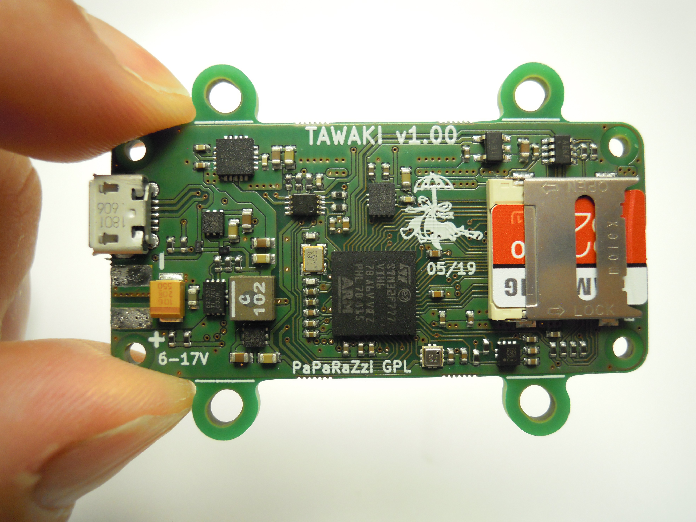  

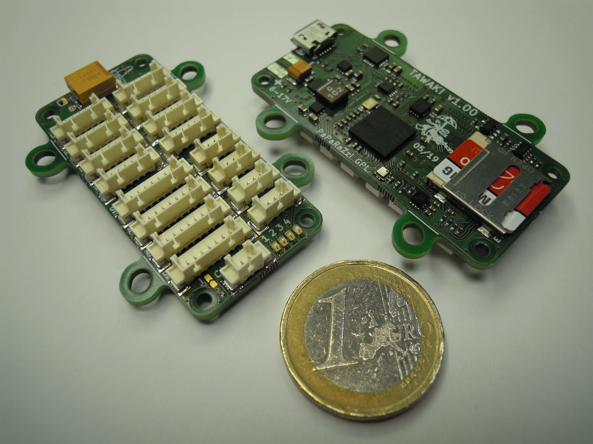

## Hardware Revision History

| Version # | Release Date | Release Notes |
| --- | --- | --- |
| v1.10 | 03/2020 | AUXa4 = PA3<br>AUXb1 = PA6<br>USB Vbus resistor bridge added.<br>C43 value increased. |
| v1.00 | 07/2019 | Initial release of Tawaki |

## Overview

### Pictures

- 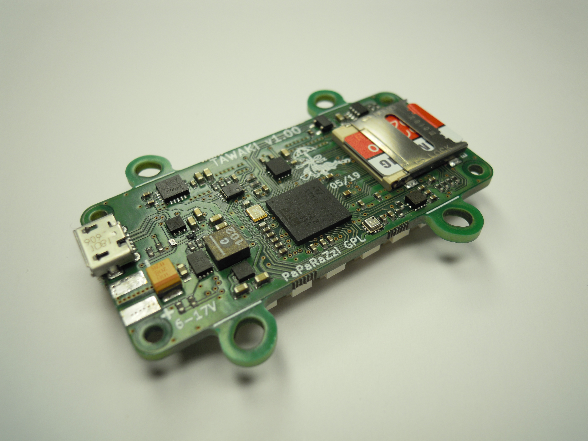
- 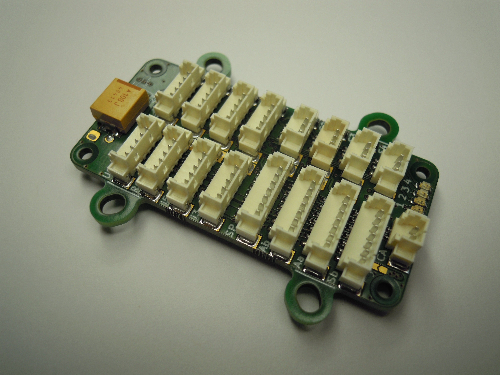
- 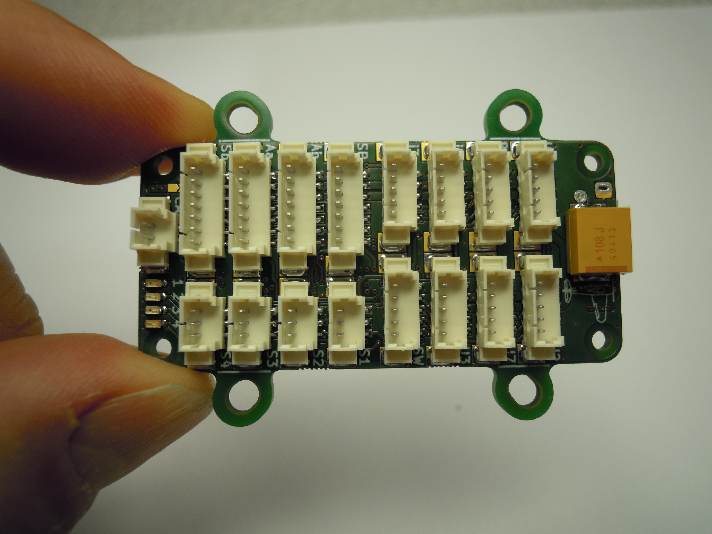
- 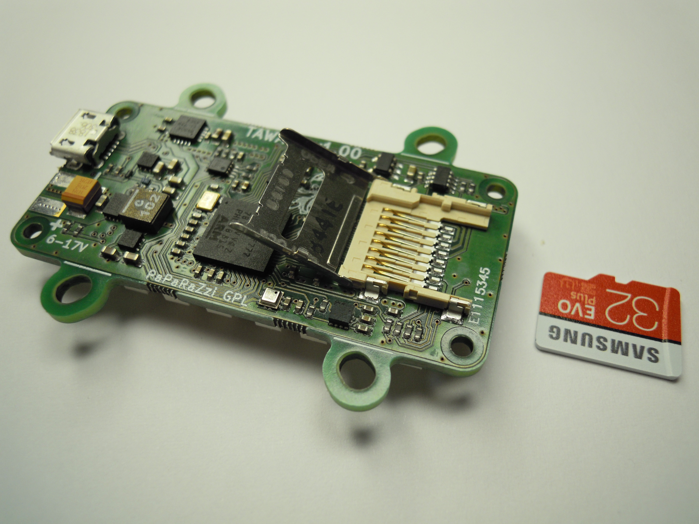
- 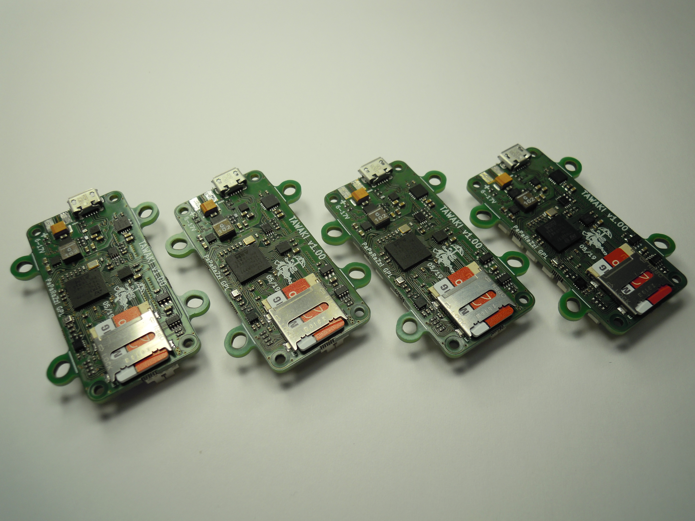

### Key Features

- STMicro [STM32F777VI](https://www.st.com/en/microcontrollers-microprocessors/stm32f777vi.html) Micro Controller Unit
  - ARM Cortex-M7, 216 MHz CPU, FPU & DSP instructions, 2 Mbytes Flash, 512 Kbytes SRAM, General-purpose DMA, HW Crypto,etc.
- On-board Sensors
  - 6 DOF Accelerometers & Gyrometers TDK-Invensense [ICM-20600](https://www.invensense.com/products/motion-tracking/6-axis/icm-20600/)
  - 3 DOF Magnetometer STMicro [LIS3MDL](https://www.st.com/en/mems-and-sensors/lis3mdl.html)
  - Baro-Altimeter Bosch [BMP388](https://www.bosch-sensortec.com/bst/products/all_products/bmp388)
- 8x Servos or ESC outputs (PWM/OneShot/DShot) + D-Shot Telemetry serial input
- 2x RC Receiver Inputs (S.BUS, PPM & Spektrum Satellite compatible, including receiver binding)
- Communication Buses
  - 3x UARTs (including one with hardware flow control signals)
  - 1x I2C bus (3.3V and 5V logic level)
  - 1x SPI bus (with Slave Select, Master or Slave)
  - 1x CAN bus
  - 1x USB (Micro-B & remote) : DFU mode (download) or USB storage (direct access to MicroSD card) or FullSpeed Mode
- 8x Auxiliary Inputs/Outputs spread over 2 connectors (8x ADC, 8x Timers different from servos, x1 UART, etc.)
- MicroSD card (+ dedicated power supply for emergency files closing system)
- Debug Connector (Serial Wire Debug)
- Power
  - source 2 to 4 Lipo cells (6 to 17v)
  - 5V/4A (max total for Tawaki + Servos + Payload)
  - 3.3V/3A Low Noise (max total for payload)
  - Controlled PowerSwitch 5V/2A supply on AUX A connector
- x4 Status Leds
- Connectors fully compatible with Apogee autopilot
- Mechanical
  - 53 x 25mm (2.1" x 0.98"), including 4x Φ2mm mounting holes (shares the same external dimensions and mounting points as Apogee)
  - 4x Φ3mm extra mounting slotted holes, 30 to 31mm spacing (30.5mm standard from Racers ESC, GPS modules, etc. )
  - 11g (0.4 oz) (including Micro-SD card)

### Pinout

#### Simplified Pinout Diagram (Paparazzi use)

*Pins Name and Type are specified with respect to the Autopilot Board*  

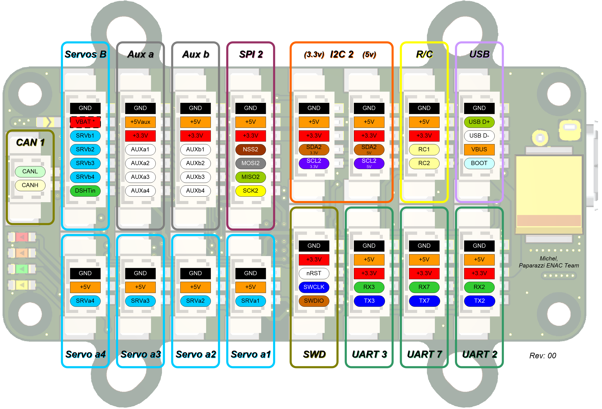

#### Simplified Pinout Tables (Paparazzi use)

**Servos a1 / a2 / a3 / a4**

| Pin # | Name | Type | MCU Port | MCU Resource | Description |
| --- | --- | --- | --- | --- | --- |
| 1 | <span class="pin-black-white">GND</span> | PWR | - | - | common ground |
| 2 | <span class="pin-orange">+5V</span> | PWR | - | - | 5V Rail from autopilot |
| 3 | <span class="pin-cyan">SRVa1<br>SRVa2<br>SRVa3<br>SRVa4</span> | OUT | PE9<br>PE11<br>PE13<br>PE14 | Tim1.Ch1<br>Tim1.Ch2<br>Tim1.Ch3<br>Tim1.Ch4 | Servo signal (PWM) |

**Servos b**

| Pin # | Name | Type | MCU Port | MCU Resource | Description |
| --- | --- | --- | --- | --- | --- |
| 1 | <span class="pin-black-white">GND</span> | PWR | - | - | common ground |
| 2 | <span class="pin-orangered">VBAT</span> | PWR (IN/OUT) | - | - | Battery Rail (if solder bridge JP1 ON) |
| 3 | <span class="pin-cyan">SRVb1</span> | OUT | PB6 | Tim4.Ch1 | Servo signal (PWM) |
| 4 | <span class="pin-cyan">SRVb2</span> | OUT | PB7 | Tim4.Ch2 | Servo signal (PWM) |
| 5 | <span class="pin-cyan">SRVb3</span> | OUT | PB8 | Tim4.Ch3 | Servo signal (PWM) |
| 6 | <span class="pin-cyan">SRVb4</span> | OUT | PB9 | Tim4.Ch4 | Servo signal (PWM) |
| 7 | <span class="pin-green">DSHTin</span> | IN | PB5 | UART5.Rx | DShot Telemetry serial input |

**R/C**

| Pin # | Name | Type | MCU Port | MCU Resource | Description |
| --- | --- | --- | --- | --- | --- |
| 1 | <span class="pin-black-white">GND</span> | PWR | - | - | common ground |
| 2 | <span class="pin-orange">+5V</span> | PWR | - | - | 5V Rail from autopilot |
| 3 | <span class="pin-red">+3.3V</span> | PWR | - | - | 3.3V Rail from autopilot |
| 4 | <span class="pin-lightyellow">RC1</span> | IN | PE0 | UART8.Rx | (5V Tolerant) Serial (SBUS, Spektrum, etc.) |
| 5 | <span class="pin-lightyellow">RCaux</span> | I/O | PC6 | UART6.Tx<br>Tim3.Ch1<br>Tim8.Ch1 | (5V Tolerant) Serial (SBUS, Spektrum, etc.) or PPM Stream RC receiver signal |

**UART2**

| Pin # | Name | Type | MCU Port | Description |
| --- | --- | --- | --- | --- |
| 1 | <span class="pin-black-white">GND</span> | PWR | - | common ground |
| 2 | <span class="pin-orange">+5V</span> | PWR | - | 5V Rail from autopilot |
| 3 | <span class="pin-red">+3.3V</span> | PWR | - | 3.3V Rail from autopilot |
| 4 | <span class="pin-green-white">RX2</span> | IN | PD6 | UART2 Serial Input (3.3V level) |
| 5 | <span class="pin-blue-white">TX2</span> | OUT | PD5 | UART2 Serial Output (3.3V level) |

**UART3**

| Pin # | Name | Type | MCU Port | Description |
| --- | --- | --- | --- | --- |
| 1 | <span class="pin-black-white">GND</span> | PWR | - | common ground |
| 2 | <span class="pin-orange">+5V</span> | PWR | - | 5V Rail from autopilot |
| 3 | <span class="pin-red">+3.3V</span> | PWR | - | 3.3V Rail from autopilot |
| 4 | <span class="pin-green-white">RX3</span> | IN | PD9 | UART3 Serial Input (3.3V level) |
| 5 | <span class="pin-blue-white">TX3</span> | OUT | PD8 | UART3 Serial Output (3.3V level) |

**UART7**

| Pin # | Name | Type | MCU Port | Description |
| --- | --- | --- | --- | --- |
| 1 | <span class="pin-black-white">GND</span> | PWR | - | common ground |
| 2 | <span class="pin-orange">+5V</span> | PWR | - | 5V Rail from autopilot |
| 3 | <span class="pin-red">+3.3V</span> | PWR | - | 3.3V Rail from autopilot |
| 4 | <span class="pin-green-white">RX7</span> | IN | PB3 | UART7 Serial Input (3.3V level) |
| 5 | <span class="pin-blue-white">TX7</span> | OUT | PA15 | UART7 Serial Output (3.3V level) |

**I2C2 (3V3)**

| Pin # | Name | Type | MCU Port | Description |
| --- | --- | --- | --- | --- |
| 1 | <span class="pin-black-white">GND</span> | PWR | - | common ground |
| 2 | <span class="pin-orange">+5V</span> | PWR | - | 5V Rail from autopilot |
| 3 | <span class="pin-red">+3.3V</span> | PWR | - | 3.3V Rail from autopilot |
| 4 | <span class="pin-sienna-white">SDA2 ( 3.3V)</span> | Open Drain I/O | PB11 | I2C2 bus Serial DAta ( 3.3V level , 2.2kΩ pull-up) |
| 5 | <span class="pin-blue-white">SCL2 ( 3.3V)</span> | Open Drain I/O | PB10 | I2C12 bus Serial CLock ( 3.3V level , 2.2kΩ pull-up) |

**I2C2 (5V)**

| Pin # | Name | Type | MCU Port | Description |
| --- | --- | --- | --- | --- |
| 1 | <span class="pin-black-white">GND</span> | PWR | - | common ground |
| 2 | <span class="pin-orange">+5V</span> | PWR | - | 5V Rail from autopilot |
| 3 | <span class="pin-red">+3.3V</span> | PWR | - | 3.3V Rail from autopilot |
| 4 | <span class="pin-sienna-white">SDA2 ( 5V)</span> | Open Drain I/O | PB11 | I2C2 bus Serial DAta ( 5V level , 2.2kΩ pull-up) |
| 5 | <span class="pin-blue-white">SCL2 ( 5V)</span> | Open Drain I/O | PB10 | I2C12 bus Serial CLock ( 5V level , 2.2kΩ pull-up) |

**SPI2**

| Pin # | Name | Type | MCU Port | Description |
| --- | --- | --- | --- | --- |
| 1 | <span class="pin-black-white">GND</span> | PWR | - | common ground |
| 2 | <span class="pin-orange">+5V</span> | PWR | - | 5V Rail from autopilot |
| 3 | <span class="pin-red">+3.3V</span> | PWR | - | 3.3V Rail from autopilot |
| 4 | <span class="pin-sienna-white">NSS2</span> | OUT | PB12 | Slave Select. Selects the SPI slave |
| 5 | <span class="pin-grey-white">MOSI2</span> | I/O | PB15 | SPI2 Master Out Slave In. Data output from master / data input to slave |
| 6 | <span class="pin-green-white">MISO2</span> | I/O | PB14 | SPI2 Master In Slave Out. Data input to master / data output from slave |
| 7 | <span class="pin-yellow">SCK2</span> | I/O | PD3 | SPI2 Serial clock. Clock output from master or input to slave |

**CAN**

| Pin # | Name | Type | MCU Port | Description |
| --- | --- | --- | --- | --- |
| 1 | <span class="pin-green-white">CANL</span> | I/O | - | CAN bidirectional - line |
| 2 | <span class="pin-yellow">CANH</span> | I/O | - | CAN bidirectional + line |

*Note: Embedded 120Ω terminator resistor.*  

**AUX a**

| Pin # | Name | Type | MCU Port | MCU Resource | Description |
| --- | --- | --- | --- | --- | --- |
| 1 | <span class="pin-black-white">GND</span> | PWR | - | - | common ground |
| 2 | <span class="pin-orange">+5V Aux</span> | PWR | (Controlled by) PC13 | - | 5V from autopilot through Power Switch<br>(PC13 = Low =&gt; OFF / PC13 = High =&gt; ON) |
| 3 | <span class="pin-red-white">+3.3V</span> | PWR | - | - | 3.3V Rail from autopilot |
| 4 | <span class="pin-efefef">AUXa1</span> | I/O | PA0 | ADC1+2+3.In0<br>Tim2.Ch1<br>Tim5.Ch1<br>UART4.Tx<br>UART2.CTS | General Purpose I/O |
| 5 | <span class="pin-efefef">AUXa2</span> | I/O | PA1 | ADC1+2+3.In1<br>Tim2.Ch2<br>Tim5.Ch2<br>UART4.Rx<br>UART2.RTS | General Purpose I/O |
| 6 | <span class="pin-efefef">AUXa3</span> | I/O | PA2 | ADC1+2+3.In2<br>Tim2.Ch3<br>Tim5.Ch3<br>Tim9.Ch1 <br> | General Purpose I/O |
| 7 | <span class="pin-efefef">AUXa4</span> | I/O | PA3 | ADC1+2+3.In3<br>Tim2.Ch4<br>Tim5.Ch4<br>Tim9.Ch2 | General Purpose I/O |

**AUX b**

| Pin # | Name | Type | MCU Port | MCU Resource | Description |
| --- | --- | --- | --- | --- | --- |
| 1 | <span class="pin-black-white">GND</span> | PWR | - | - | common ground |
| 2 | <span class="pin-orange">+5V</span> | PWR | - | - | 5V Rail from autopilot |
| 3 | <span class="pin-red-white">+3.3V</span> | PWR | - | - | 3.3V Rail from autopilot |
| 4 | <span class="pin-efefef">AUXb1</span> | I/O | PA6 | ADC1+2.In6<br>Tim3.Ch1<br>Tim13.Ch1 | General Purpose I/O |
| 5 | <span class="pin-efefef">AUXb2</span> | I/O | PA7 | ADC1+2+3.In7<br>Tim3.Ch2<br>Tim14.Ch1 | General Purpose I/O |
| 6 | <span class="pin-efefef">AUXb3</span> | I/O | PB0 | ADC1+2.In8<br>Tim3.Ch3 | General Purpose I/O |
| 7 | <span class="pin-efefef">AUXb4</span> | I/O | PB1 | ADC1+2.In9<br>Tim3.Ch4 | General Purpose I/O |

**USB**

| Pin # | Name | Type | MCU Port | Description |
| --- | --- | --- | --- | --- |
| 1 | <span class="pin-black-white">GND</span> | PWR | - | common ground |
| 2 | <span class="pin-green-white">USB+</span> | I/O | PA12 | USB bidirectional D+ line |
| 3 | <span class="pin-white">USB-</span> | I/O | PA11 | USB bidirectional D- line |
| 4 | <span class="pin-orange">VBUS</span> | IN | PA9 | USB bus power (5V) |
| 5 | <span class="pin-e0ffff">BOOT</span> | IN | BOOT0 | DFU or USB Mode selection (BOOT0 MCU pin) |

*Note: USB Micro-B and Molex Picoblade connectors are in parallel, only one should be connected at a time.*  

**SWD**

| Pin # | Name | Type | MCU Port | Description |
| --- | --- | --- | --- | --- |
| 1 | <span class="pin-black-white">GND</span> | PWR | - | common ground |
| 2 | <span class="pin-red">+3.3V</span> | PWR | - | 3.3V Rail from autopilot |
| 3 | <span class="pin-white">nRST</span> | IN | NRST | MCU Reset (active low) |
| 4 | <span class="pin-blue-white">SWCLK</span> | IN | PA14 | Serial Wire Clock |
| 5 | <span class="pin-sienna-white">SWDIO</span> | I/O | PA13 | Serial Wire Data Input/Output |

## Detailed Features

### Power Supply

```{warning}
Use only one power source at a time.
```

There are several ways to power the Tawaki board:

- with a battery or any power source that delivers between 6 and 17V
- by connecting it to a USB port
- with a power source that delivers a regulated, stable 5V

Each of these methods is detailed below.

#### Powering using battery/external source soldered onto battery pads

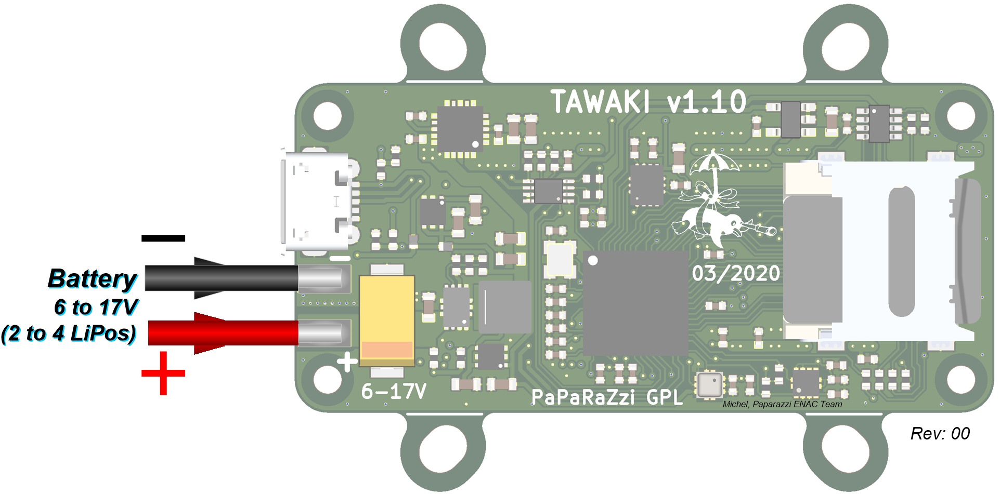  

This is the basic setup: the Tawaki then generates all the internal power sources needed by its components. Additionally, the board provides +5V and +3.3V power sources through dedicated ports for external payload.  
Limitations:

- input power source range: 6-17V (2-4 Lipo cells)
- maximum current usable by both Tawaki and payload on the +5V: I(5V)\<4A
- maximum current usable for payload on the +3.3V: I(3.3V)\<3A
- maximum total current usable: 4A

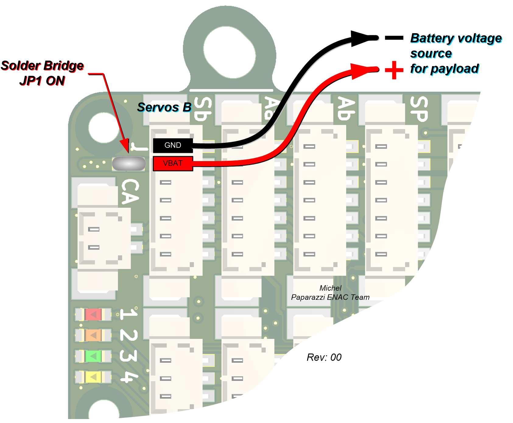  

With this setup, the external power source is available on the “VBAT” pin of the “Servos B” header - but only if solder bridge JP1 is jumped (turned ON) with a small blob of solder.  
Limitation:

- maximum current used on the “VBAT” pin must be less than 1A (because of the header’s specifications)

#### Powering using battery/external source connected on "Servos B" header

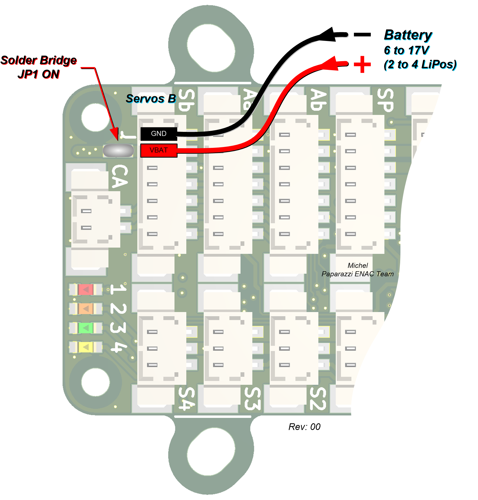  

With this setup, the “GND”(-) and “VBAT”(+) pins of the “Servos B” header are used as the main entry ports for the external power source - but only if solder bridge JP1 is jumped (turned ON) with a small blob of solder. This can be interesting when the ESC already delivers the external power source voltage through its command and control signals (as is frequently the case on multi-rotors).  
Limitations:  

- input power source range: 6-17V (2-4 Lipo cells)
- maximum total current usable: 1A (because of the header’s specifications)

#### Powering using USB Micro-B only

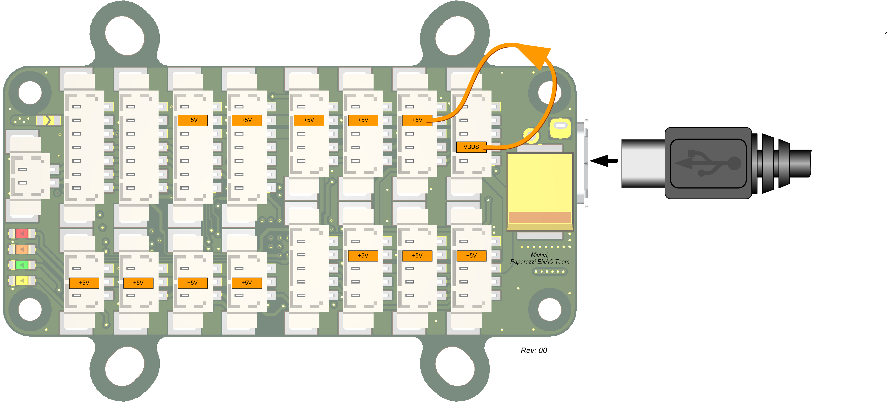  

It is possible to power the Tawaki with only a host computer, through the USB Micro-B port. This setup allows to power the board and all its components, while at the same time flashing it.  
In this case, the "VBUS" pin of the "USB" header must be connected to the "+5V" pin of any header that is equipped with one - with the exception of the "5Vaux" pin of the "AUX a" header.  
Limitation:  

- the host computer must be capable of providing the current needed for: powering the board, and any potential external payload. With a maximum limit of 1A (because of the header’s specifications)  

*Note: with this setup, the voltage of the external power source (VBAT) obviously cannot be measured by the micro-controller (MCU).*

#### Powering using external 5V source

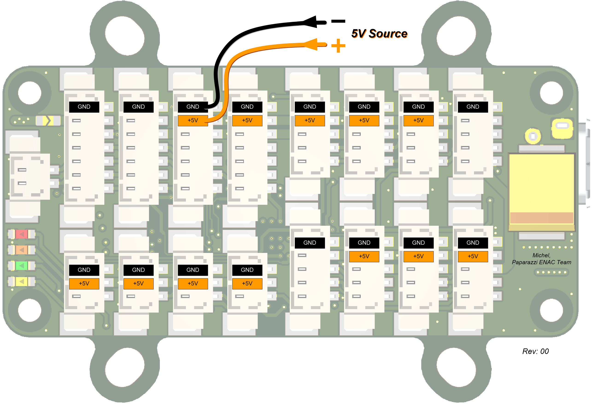  

In some cases the external power source is out of range and cannot be used, but an external 5V power source is available (for example provided by the ESC). In this case, the external 5V power source must be connected to the "+5V" and "GND" pins of any header that are equipped with them - with the exception of the "5Vaux" pin of the "AUX a" header.  
Limitations:  

- voltage range: 4-6V
- the external 5V power source must be capable of providing the current needed for: powering the board, and any potential external payload. With a maximum limit of 1A (because of the headers' specifications)
- the "VBUS" pin of the "USB" header must not be connected to the "+5V" pin of any header

*Note: with this setup, the voltage of the external power source (VBAT) obviously cannot be measured by the micro-controller (MCU).*

### USB Modes

#### Flash (DFU) mode

In this configuration, *BOOT* pin is connected to *VBUS* pin (#4 & \#5 "USB" header).  
If USB cable is plugged and autopilot is not powered or USB cable plugged before autopilot is powered, board enter DFU mode and is ready to be flashed.  

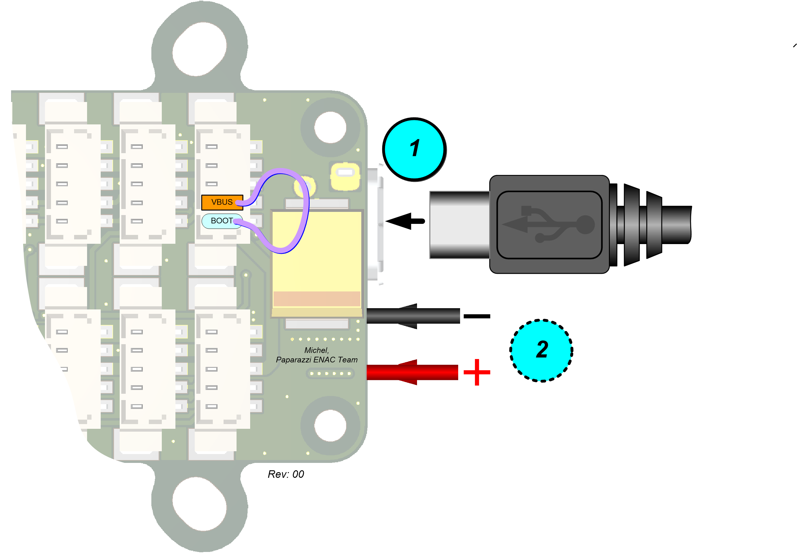  

#### USB Storage mode

In this configuration, *BOOT* pin is connected to *VBUS* pin (#4 & \#5 "USB" header).  
If USB cable is plugged after autopilot is powered, autopilot task is stopped and board enters in USB storage mode to make SDcard content easily available by host as for an USB Pendrive. When unmounted and unplugged, autopilot task restart.

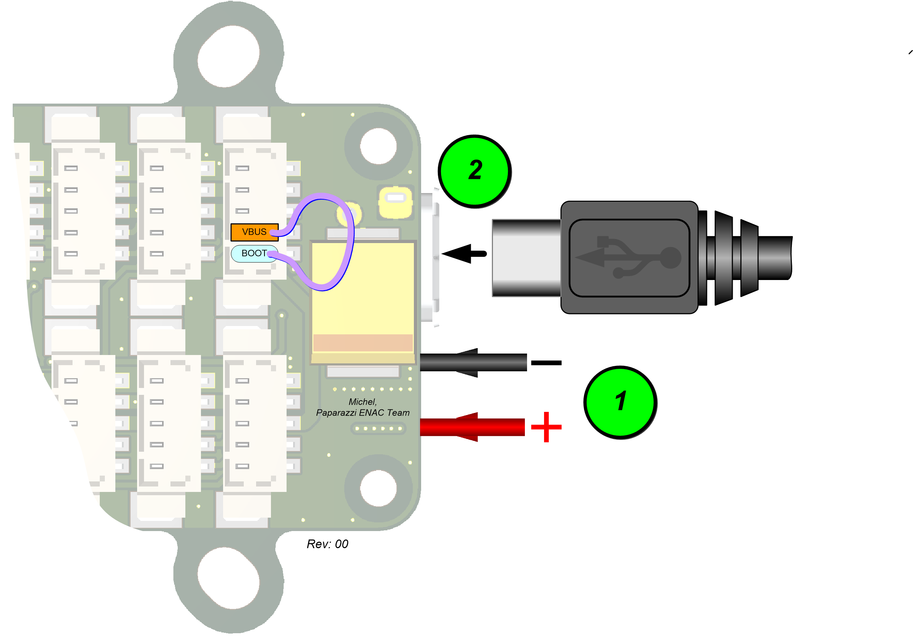  

#### Full Speed USB mode

Documentation not yet provided.

### General Pinout

*Pins Name and Type are specified with respect to the Autopilot Board*  

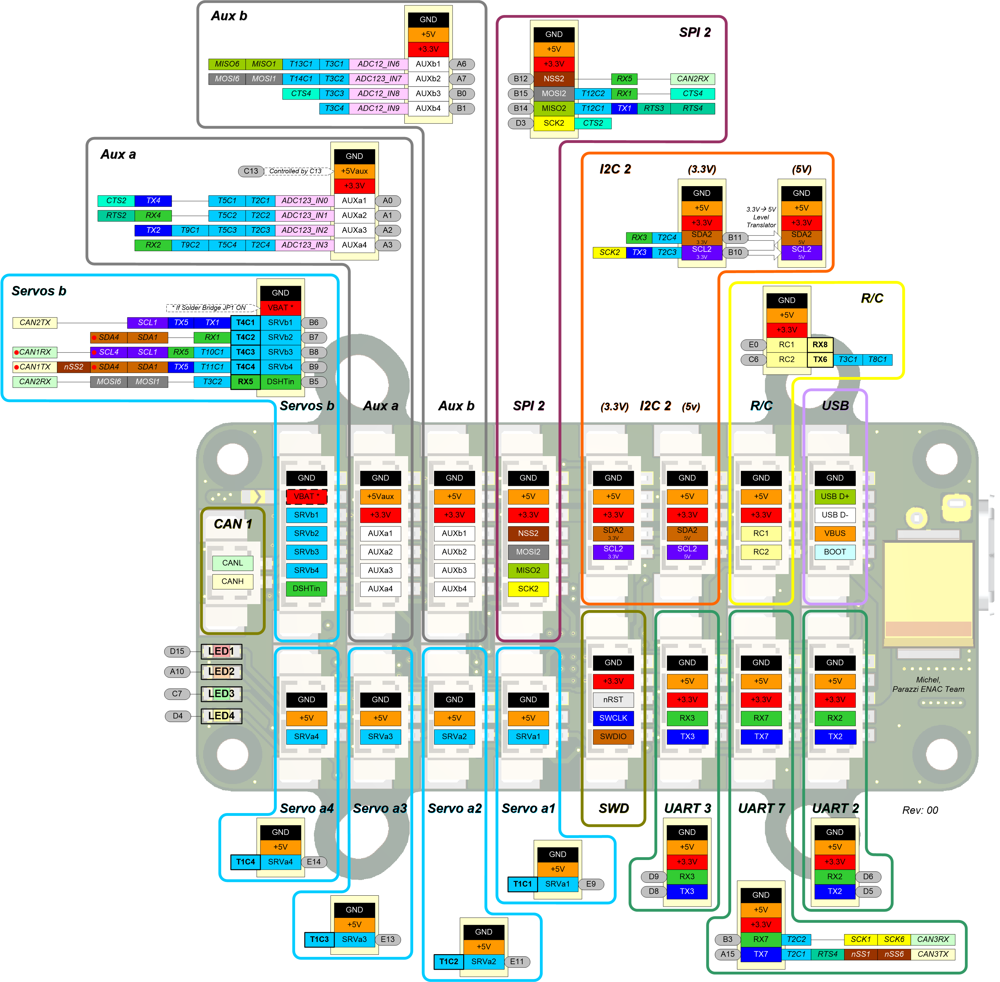

### Schematic

Documentation not yet provided.

### Mechanical

#### Mechanical Dimensions

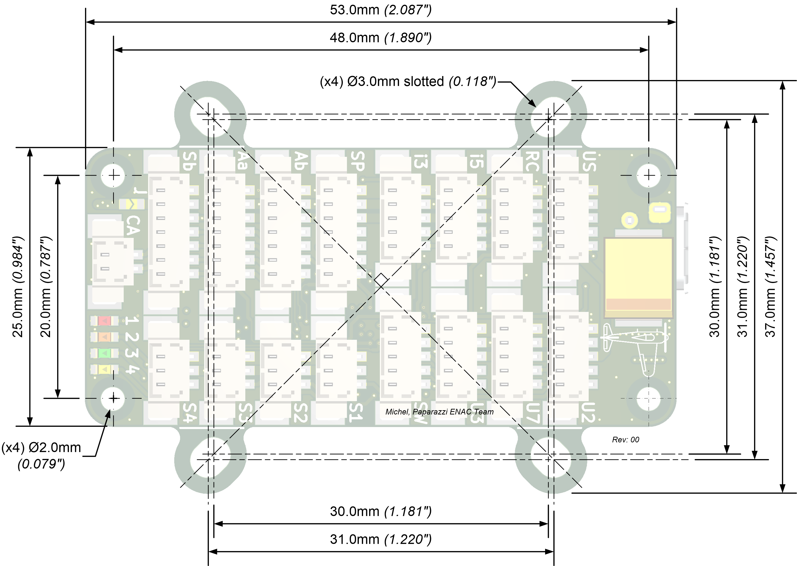

#### CAD Files / 3D Model

[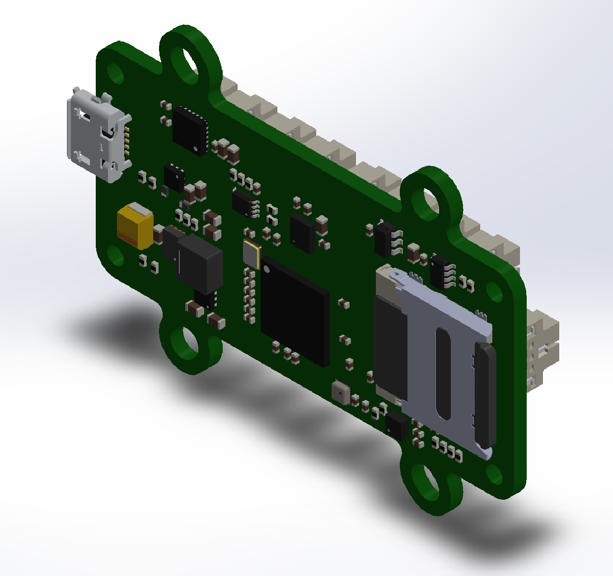](downloads/tawaki-v1/Tawaki_v100_CAD.zip) [*Download Tawaki v1.00 CAD File (zipped STEP file)*](downloads/tawaki-v1/Tawaki_v100_CAD.zip)  

## Example of Airborne Equipment Electrical Connections

Documentation not yet provided.

## Board production

### Hardware Source Files

*Tawaki v1.10 hardware design (zipped Kicad 8 project)* : [Tawaki_v110.zip](http://data.recherche.enac.fr/drones/Paparazzi/hardware/Tawaki_v110.zip)

### Components Layout

[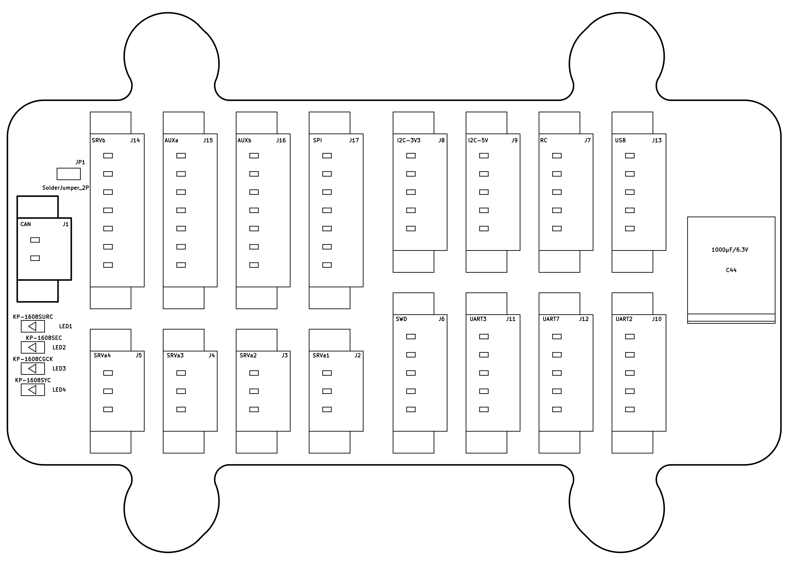](images/tawaki-v1/Tawaki_v100_bottom_components_layout.png)[Bottom components layout (pdf)](downloads/tawaki-v1/Tawaki_v100_bottom_components_layout.pdf)  
[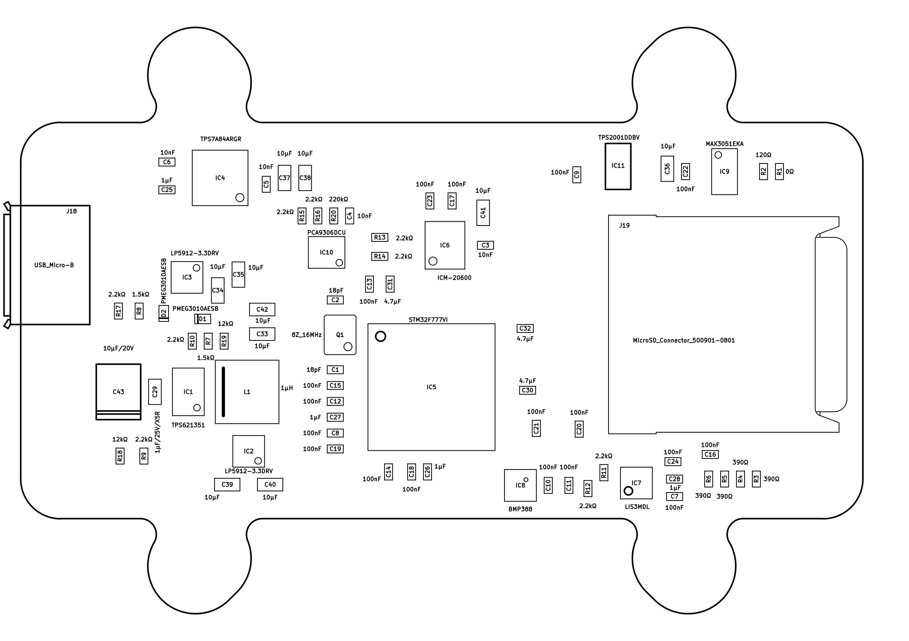](images/tawaki-v1/Tawaki_v100_top_components_layout.png)[Top components layout (pdf)](downloads/tawaki-v1/Tawaki_v100_top_components_layout.pdf)

## Programming

Documentation not yet provided.

## Debugging

### Debugging with STM Discovery ST-LINK/V2 embedded debug tool

Documentation not yet provided.

### Debugging with BlackMagic probe

Documentation not yet provided.

### Debugging with [CricketProbe](https://wiki.paparazziuav.org/wiki/CricketProbe/v1.00)

Documentation not yet provided.

## Source code

Available in the [Paparazzi source repository](https://github.com/paparazzi/paparazzi/tree/master/sw/airborne/boards/tawaki).


## Attribution

Ported from [Tawaki/v1.10](https://wiki.paparazziuav.org/wiki/Tawaki/v1.10), wiki revision [26162](https://wiki.paparazziuav.org/w/index.php?oldid=26162) (2024-06-06). Contributors: Ghattenb, Michel, Fabien-B. Illustrations and downloads are copied from the archived wiki uploads.
