# Tawaki v2

Tawaki v2 is an STM32H753-based autopilot board. This page documents hardware revision **v2.01**, including its connectors, power supply, and USB modes.

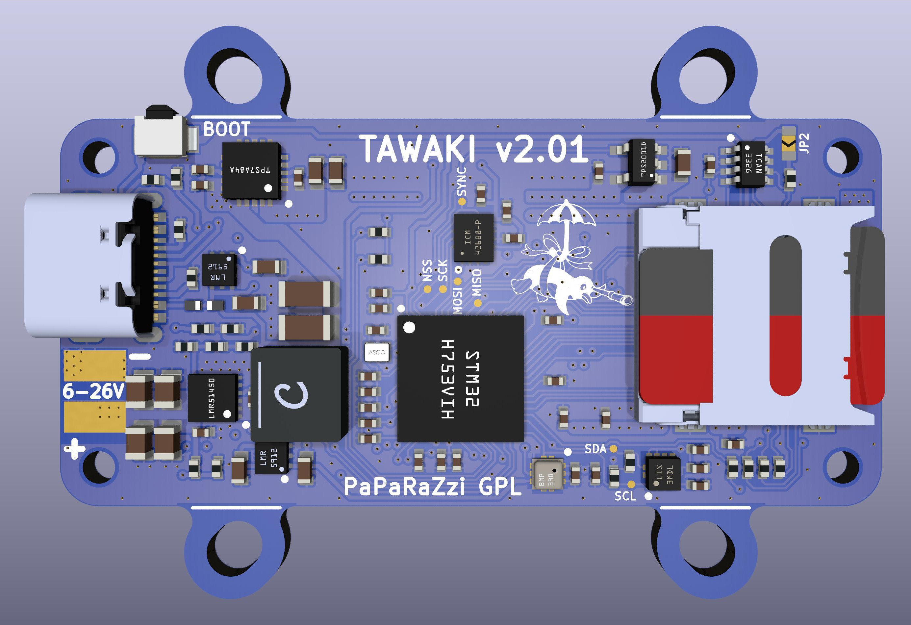

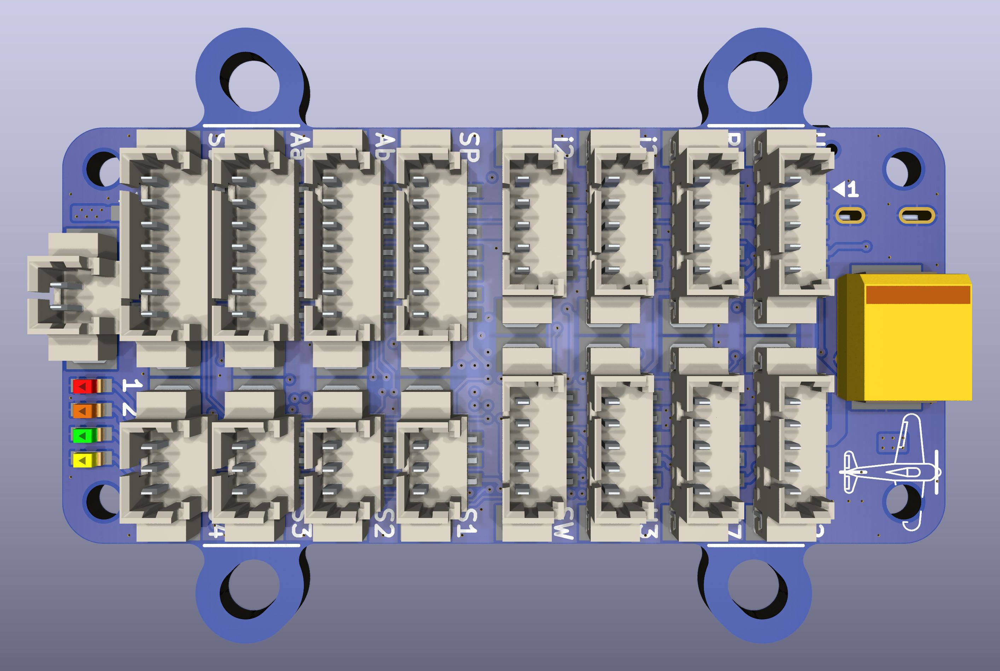

## Hardware Revision History

| Version # | Release Date | Release Notes |
| --- | --- | --- |
| v2.01 | 03/2024 | Push-Button added for easier boot mode selection<br>I2C 5V connector replaced by I2C 3.3V<br>Solder jumper JP2 added for CAN bus resistor termination setup |
| v2.00 | 10/2023 | Initial release of Tawaki v2 |

## Overview

### Pictures

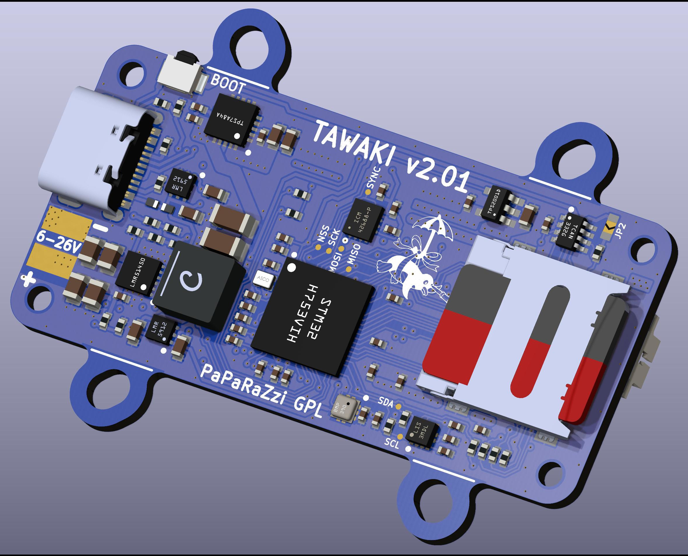 

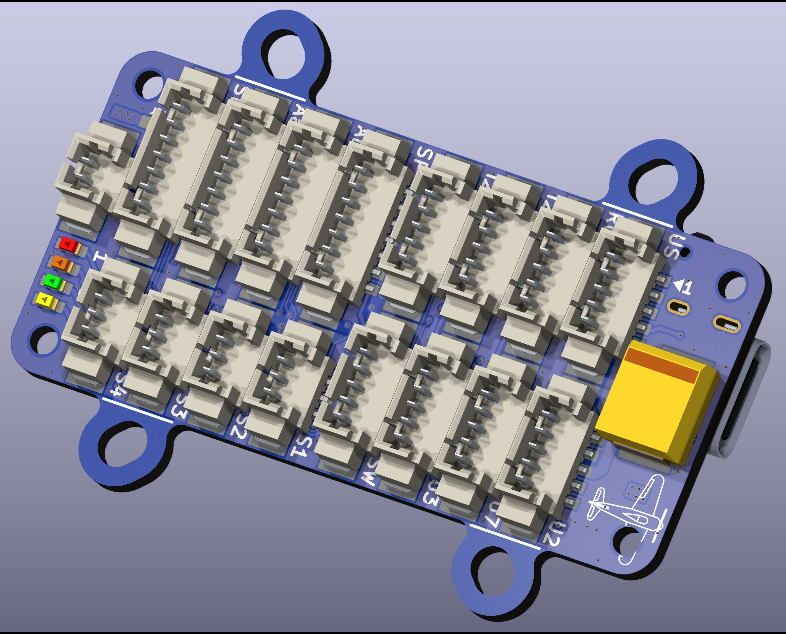

### Key Features

- STMicro [STM32H753VIH](https://www.st.com/en/microcontrollers-microprocessors/stm32h753vi.html) Micro Controller Unit
  - ARM Cortex-M7, 480 MHz CPU, FPU & DSP instructions, 2MBytes Flash, 1MB RAM, etc.
- On-board Sensors
  - 6 DOF Accelerometers & Gyrometers TDK-Invensense [ICM-42688-P](https://invensense.tdk.com/products/motion-tracking/6-axis/icm-42688-p/)
  - 3 DOF Magnetometer STMicro [LIS3MDL](https://www.st.com/en/mems-and-sensors/lis3mdl.html)
  - Baro-Altimeter Bosch [BMP390](https://www.bosch-sensortec.com/products/environmental-sensors/pressure-sensors/bmp390/)
- 8x Servos or ESC outputs: PWM/OneShot/DShot (+D-Shot Telemetry serial input)/DShot bidir
- 2x RC Receiver Inputs (S.BUS, PPM & Spektrum Satellite compatible, including receiver binding)
- Communication Buses
  - 3x UARTs (including one with hardware flow control signals)
  - 1x I2C bus (3.3V logic level, 2 connectors)
  - 1x SPI bus (with Slave Select, Master or Slave)
  - 1x CAN/CANFD bus
  - 1x USB-C (& remote) : DFU mode (download) or USB storage (direct access to MicroSD card) or FullSpeed Mode
- 8x Auxiliary Inputs/Outputs spread over 2 connectors (8x ADC, 8x Timers different from servos, x1 UART, etc.)
- MicroSD card (+ dedicated power supply for emergency files closing system)
- Debug Connector (Serial Wire Debug)
- Power
  - source 2 to 6 Lipo cells (6 to 26v)
  - 5V/5A (max total for Tawaki + Servos + Payload)
  - 3.3V/3A Low Noise (max total for payload)
  - Controlled PowerSwitch 5V/2A supply on AUX A connector
- x4 Status Leds
- Connectors fully compatible with Tawaki v1 & Apogee autopilot
- Mechanical
  - 53 x 25mm (2.1" x 0.98"), including 4x Φ2mm mounting holes (shares the same external dimensions and mounting points as Tawaki v1 & Apogee)
  - 4x Φ3mm extra mounting slotted holes, 30 to 31mm spacing (30.5mm standard from Racers ESC, GPS modules, etc. )
  - 11g (0.4 oz) (including Micro-SD card)

### Pinout

#### Simplified Pinout Diagram (Paparazzi use)

*Pins Name and Type are specified with respect to the Autopilot Board*  

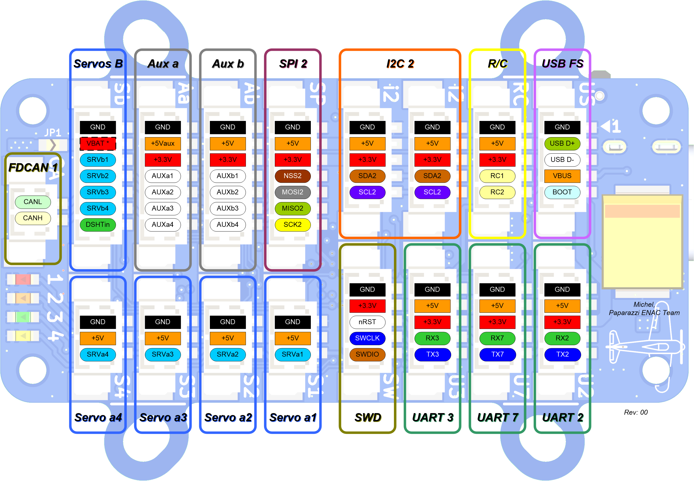

#### Simplified Pinout Tables (Paparazzi use)

:::{container} pinout

**Servos a1 / a2 / a3 / a4**

| Pin # | Name | Type | MCU Port | Primary MCU Resource | Description |
| --- | --- | --- | --- | --- | --- |
| 1 | <span class="pin-black-white">GND</span> | PWR | - | - | common ground |
| 2 | <span class="pin-orange">+5V</span> | PWR | - | - | 5V Rail from autopilot |
| 3 | <span class="pin-cyan">SRVa1<br>SRVa2<br>SRVa3<br>SRVa4</span> | OUT | PE9<br>PE11<br>PE13<br>PE14 | Tim1.Ch1<br>Tim1.Ch2<br>Tim1.Ch3<br>Tim1.Ch4 | Servo signal (PWM) |

**Servos b**

| Pin # | Name | Type | MCU Port | Primary MCU Resource | Description |
| --- | --- | --- | --- | --- | --- |
| 1 | <span class="pin-black-white">GND</span> | PWR | - | - | common ground |
| 2 | <span class="pin-orangered">VBAT</span> | PWR(IN/OUT) | - | - | Battery Rail (if solder bridge JP1 ON) |
| 3 | <span class="pin-cyan">SRVb1</span> | OUT | PA6 | Tim3.Ch1 | Servo signal (PWM) |
| 4 | <span class="pin-cyan">SRVb2</span> | OUT | PA7 | Tim3.Ch2 | Servo signal (PWM) |
| 5 | <span class="pin-cyan">SRVb3</span> | OUT | PB0 | Tim3.Ch3 | Servo signal (PWM) |
| 6 | <span class="pin-cyan">SRVb4</span> | OUT | PB1 | Tim3.Ch4 | Servo signal (PWM) |
| 7 | <span class="pin-green">DSHTin</span> | IN | PA10 | UART1.Rx | DShot Telemetry serial input |

**R/C**

| Pin # | Name | Type | MCU Port | Possible MCU Resource | Description |
| --- | --- | --- | --- | --- | --- |
| 1 | <span class="pin-black-white">GND</span> | PWR | - | - | common ground |
| 2 | <span class="pin-orange">+5V</span> | PWR | - | - | 5V Rail from autopilot |
| 3 | <span class="pin-red">+3.3V</span> | PWR | - | - | 3.3V Rail from autopilot |
| 4 | <span class="pin-lightyellow">RC1</span> | IN | PE0 | UART8.Rx | (5V Tolerant) Serial (SBUS, Spektrum, etc.) |
| 5 | <span class="pin-lightyellow">RCaux</span> | I/O | PC6 | UART6.Tx<br>Tim3.Ch1<br>Tim8.Ch1 | (5V Tolerant) Serial (SBUS, Spektrum, etc.) or PPM Stream RC receiver signal |

**UART2**

| Pin # | Name | Type | MCU Port | Primary MCU Resource | Description |
| --- | --- | --- | --- | --- | --- |
| 1 | <span class="pin-black-white">GND</span> | PWR | - | - | common ground |
| 2 | <span class="pin-orange">+5V</span> | PWR | - | - | 5V Rail from autopilot |
| 3 | <span class="pin-red">+3.3V</span> | PWR | - | - | 3.3V Rail from autopilot |
| 4 | <span class="pin-green-white">RX2</span> | IN | PD6 | UART2.Rx | Serial Input (3.3V level) |
| 5 | <span class="pin-blue-white">TX2</span> | OUT | PD5 | UART2.Tx | Serial Output (3.3V level) |

**UART3**

| Pin # | Name | Type | MCU Port | Primary MCU Resource | Description |
| --- | --- | --- | --- | --- | --- |
| 1 | <span class="pin-black-white">GND</span> | PWR | - | - | common ground |
| 2 | <span class="pin-orange">+5V</span> | PWR | - | - | 5V Rail from autopilot |
| 3 | <span class="pin-red">+3.3V</span> | PWR | - | - | 3.3V Rail from autopilot |
| 4 | <span class="pin-green-white">RX3</span> | IN | PD9 | UART3.Rx | Serial Input (3.3V level) |
| 5 | <span class="pin-blue-white">TX3</span> | OUT | PD8 | UART3.Tx | Serial Output (3.3V level) |

**UART7**

| Pin # | Name | Type | MCU Port | Primary MCU Resource | Description |
| --- | --- | --- | --- | --- | --- |
| 1 | <span class="pin-black-white">GND</span> | PWR | - | - | common ground |
| 2 | <span class="pin-orange">+5V</span> | PWR | - | - | 5V Rail from autopilot |
| 3 | <span class="pin-red">+3.3V</span> | PWR | - | - | 3.3V Rail from autopilot |
| 4 | <span class="pin-green-white">RX7</span> | IN | PB3 | UART7.Rx | Serial Input (3.3V level) |
| 5 | <span class="pin-blue-white">TX7</span> | OUT | PA15 | UART7.Tx | Serial Output (3.3V level) |

**I2C2 (x2)**

| Pin # | Name | Type | MCU Port | Primary MCU Resource | Description |
| --- | --- | --- | --- | --- | --- |
| 1 | <span class="pin-black-white">GND</span> | PWR | - | - | common ground |
| 2 | <span class="pin-orange">+5V</span> | PWR | - | - | 5V Rail from autopilot |
| 3 | <span class="pin-red">+3.3V</span> | PWR | - | - | 3.3V Rail from autopilot |
| 4 | <span class="pin-sienna-white">SDA2</span> | Open Drain I/O | PB11 | I2C2.SDA | Serial Bus DAta (3.3V level, 2.2kΩ pull-up) |
| 5 | <span class="pin-blue-white">SCL2</span> | Open Drain I/O | PB10 | I2C2.SCL | Serial Bus CLock (3.3V level, 2.2kΩ pull-up) |

**SPI2**

| Pin # | Name | Type | MCU Port | Primary MCU Resource | Description |
| --- | --- | --- | --- | --- | --- |
| 1 | <span class="pin-black-white">GND</span> | PWR | - | - | common ground |
| 2 | <span class="pin-orange">+5V</span> | PWR | - | - | 5V Rail from autopilot |
| 3 | <span class="pin-red">+3.3V</span> | PWR | - | - | 3.3V Rail from autopilot |
| 4 | <span class="pin-sienna-white">NSS2</span> | I/O | PB12 | SPI2.nSS | Slave Select. Selects the SPI slave |
| 5 | <span class="pin-grey-white">MOSI2</span> | I/O | PB15 | SPI2.MOSI | Master Out Slave In. Data output from master / data input to slave |
| 6 | <span class="pin-green-white">MISO2</span> | I/O | PB14 | SPI2.MISO | Master In Slave Out. Data input to master / data output from slave |
| 7 | <span class="pin-yellow">SCK2</span> | I/O | PD3 | SPI2.SCK | Serial clock. Clock output from master or input to slave |

**CAN FD**

| Pin # | Name | Type | MCU Port | MCU Resource | Description |
| --- | --- | --- | --- | --- | --- |
| 1 | <span class="pin-green-white">CANL</span> | I/O | PD0<br>PD1 | FDCAN1.Rx<br>FDCAN1.Tx | CAN FD bidirectional - line |
| 2 | <span class="pin-yellow">CANH</span> | I/O | PD0<br>PD1 | FDCAN1.Rx<br>FDCAN1.Tx | CAN FD bidirectional + line |

*Note: solder JP2 to enable embedded 120Ω terminator resistor*  

**AUX a**

| Pin # | Name | Type | MCU Port | Possible MCU Resource | Description |
| --- | --- | --- | --- | --- | --- |
| 1 | <span class="pin-black-white">GND</span> | PWR | - | - | common ground |
| 2 | <span class="pin-orange">+5V Aux</span> | PWR | (Controlled by) PC13 | - | 5V from autopilot through Power Switch<br>(PC13 = Low => OFF / PC13 = High => ON) |
| 3 | <span class="pin-red-white">+3.3V</span> | PWR | - | - | 3.3V Rail from autopilot |
| 4 | <span class="pin-d0d0d0">AUXa1</span> | I/O | PA0 | ADC1.InP16<br>Tim2.Ch1<br>Tim5.Ch1<br>UART2.CTS<br>UART4.Tx | General Purpose I/O |
| 5 | <span class="pin-d0d0d0">AUXa2</span> | I/O | PA1 | ADC1.InP17/N16<br>Tim2.Ch2<br>Tim5.Ch2<br>UART2.RTS<br>UART4.Rx | General Purpose I/O |
| 6 | <span class="pin-d0d0d0">AUXa3</span> | I/O | PA2 | ADC1/2.InP14<br>Tim2.Ch3<br>Tim5.Ch3<br>UART2.Tx | General Purpose I/O |
| 7 | <span class="pin-d0d0d0">AUXa4</span> | I/O | PA3 | ADC1/2.InP15<br>Tim2.Ch4<br>Tim5.Ch4<br>UART2.Rx | General Purpose I/O |

**AUX b**

| Pin # | Name | Type | MCU Port | Possible MCU Resource | Description |
| --- | --- | --- | --- | --- | --- |
| 1 | <span class="pin-black-white">GND</span> | PWR | - | - | common ground |
| 2 | <span class="pin-orange">+5V</span> | PWR | - | - | 5V Rail from autopilot |
| 3 | <span class="pin-red-white">+3.3V</span> | PWR | - | - | 3.3V Rail from autopilot |
| 4 | <span class="pin-d0d0d0">AUXb1</span> | I/O | PB6 | Tim4.Ch1<br>UART1.Tx<br>UART5.Tx<br>I2C1.SCL<br>CAN2.Tx | General Purpose I/O |
| 5 | <span class="pin-d0d0d0">AUXb2</span> | I/O | PB7 | Tim4.Ch2<br>UART1.Rx<br>I2C1.SDA | General Purpose I/O |
| 6 | <span class="pin-d0d0d0">AUXb3</span> | I/O | PB8 | Tim4.Ch3<br>Tim16.Ch1<br>UART4.Rx<br>I2C1.SCL | General Purpose I/O |
| 7 | <span class="pin-d0d0d0">AUXb4</span> | I/O | PB9 | Tim4.Ch4<br>Tim17.Ch1<br>UART4.Tx<br>I2C1.SDA<br>SPI2.NSS | General Purpose I/O |

**USB FS**

| *Pin \#* | *Name* | *Type* | *MCU Port* | *Description*                             |
|----------|--------|--------|------------|-------------------------------------------|
| 1        | <span class="pin-black-white">GND</span> | PWR    | \-         | common ground                             |
| 2        | <span class="pin-green-white">D+</span> | I/O    | PA12       | USB Full Speed bidirectional D+ line      |
| 3        | <span class="pin-white">D-</span> | I/O    | PA11       | USB Full Speed bidirectional D- line      |
| 4        | <span class="pin-orange">VBUS</span> | IN     | PA9        | USB bus power (5V)                        |
| 5        | <span class="pin-e0ffff">BOOT</span> | IN     | BOOT0      | DFU or USB Mode selection (BOOT0 MCU pin) |

*Note: USB-C Receptacle and Molex Picoblade connectors are in parallel, only one should be connected at a time.*  

**SWD**

| *Pin \#* | *Name* | *Type* | *MCU Port* | *Description*                 |
|----------|--------|--------|------------|-------------------------------|
| 1        | <span class="pin-black-white">GND</span> | PWR    | \-         | common ground                 |
| 2        | <span class="pin-red">+3.3V</span> | PWR    | \-         | 3.3V Rail from autopilot      |
| 3        | <span class="pin-white">nRST</span> | IN     | NRST       | MCU Reset (active low)        |
| 4        | <span class="pin-blue-white">SWCLK</span> | IN     | PA14       | Serial Wire Clock             |
| 5        | <span class="pin-sienna-white">SWDIO</span> | I/O    | PA13       | Serial Wire Data Input/Output |

:::

## Detailed Features

### Power Supply

```{warning}
Use only one power source at a time.
```

There are several ways to power the Tawaki board:

- with a battery or any power source that delivers between 6 and 26V
- by connecting it to a USB port
- with a power source that delivers a regulated, stable 5V

Each of these methods is detailed below.

#### Powering using battery/external source soldered onto battery pads

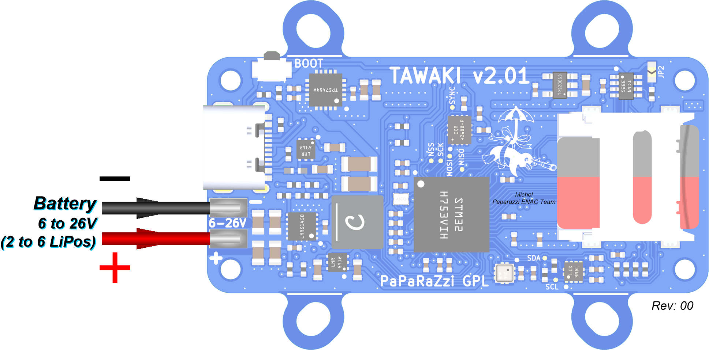

This is the basic setup: the Tawaki then generates all the internal power sources needed by its components. Additionally, the board provides +5V and +3.3V power sources through dedicated ports for external payload.  
**Limitations**:

- input power source range: **6-26V** (2-6 Lipo cells)
- maximum current usable by both Tawaki and payload on the +5V: **I(5V) \< 5A**
- maximum current usable for payload on the +3.3V: **I(3.3V) \< 3A**
- maximum total current usable: **(I(5V)+I(3.3V)) \< 5A**

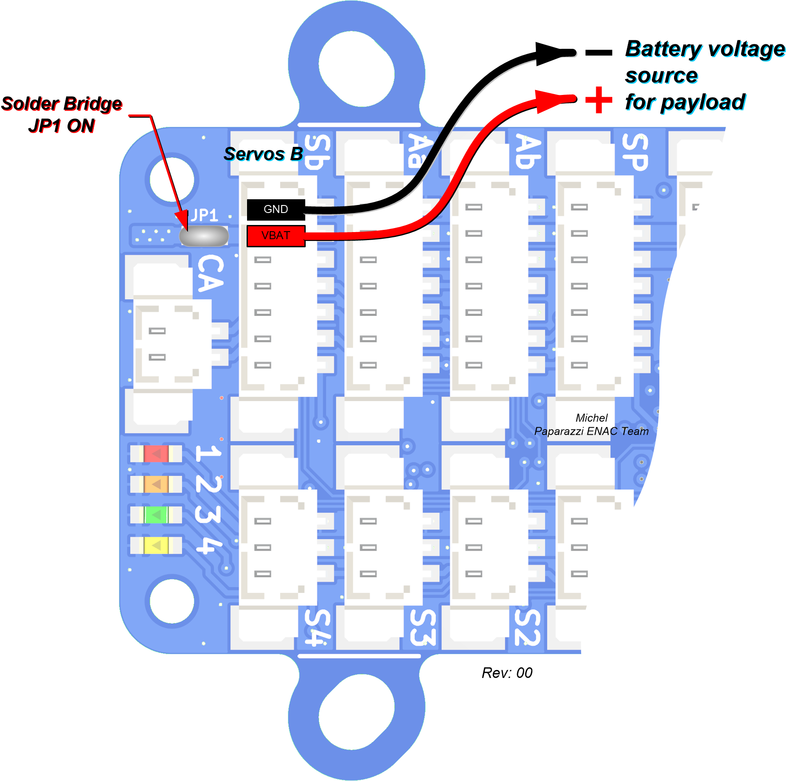

With this setup, the external power source is available on the “VBAT” pin of the “Servos B” header - but only if solder bridge JP1 is jumped (turned ON) with a small blob of solder.  
**Limitation**:

- maximum current on the “VBAT” pin: **I(Vbat) \< 1A** (because of the header’s specifications)

#### Powering using battery/external source connected on "Servos B" header

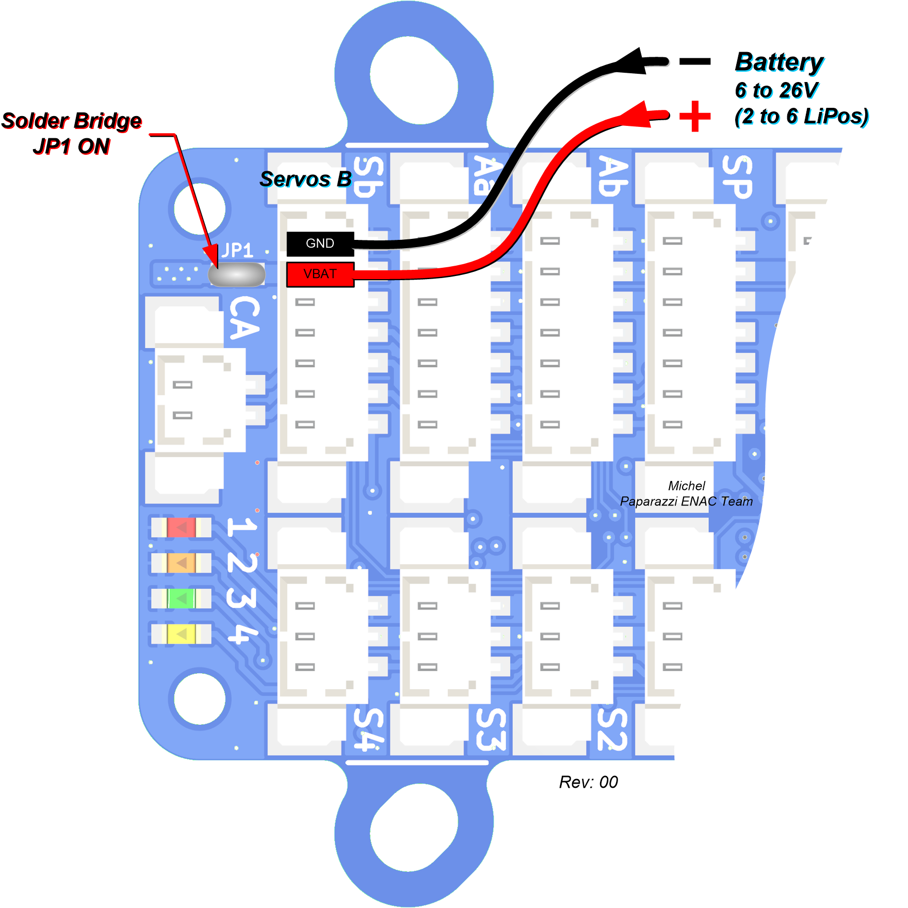

With this setup, the “GND”(-) and “VBAT”(+) pins of the “Servos B” header are used as the main entry ports for the external power source - but only if solder bridge JP1 is jumped (turned ON) with a small blob of solder. This can be interesting when the ESC already delivers the external power source voltage through its command and control signals (as is frequently the case on multi-rotors).  
**Limitations**:  

- input power source range: **6-26V** (2-6 Lipo cells)

- maximum current on the “VBAT” pin: **I(Vbat) \< 1A** (because of the header’s specifications)

#### Powering using USB-C only

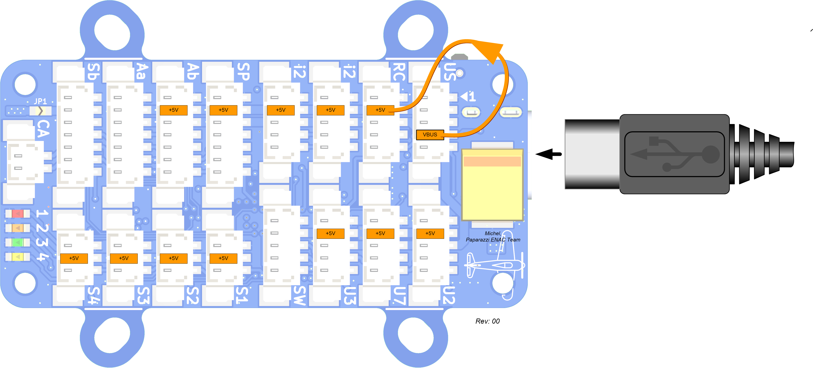

It is possible to power the Tawaki with only a host computer, through the USB-C cable. This setup allows to power the board and all its components, while at the same time flashing it.  
In this case, the "VBUS" pin of the "USB FS" header must be connected to the "+5V" pin of any header that is equipped with one - with the exception of the "5Vaux" pin of the "AUX a" header.  
**Limitation**:  

- the host computer must be capable of providing the current needed for: powering the board, and any potential external payload. With a maximum limit of 1A (because of the header’s specifications)  
*Note: with this setup, the voltage of the external power source (VBAT) obviously cannot be measured by the micro-controller (MCU).*

#### Powering using external 5V source

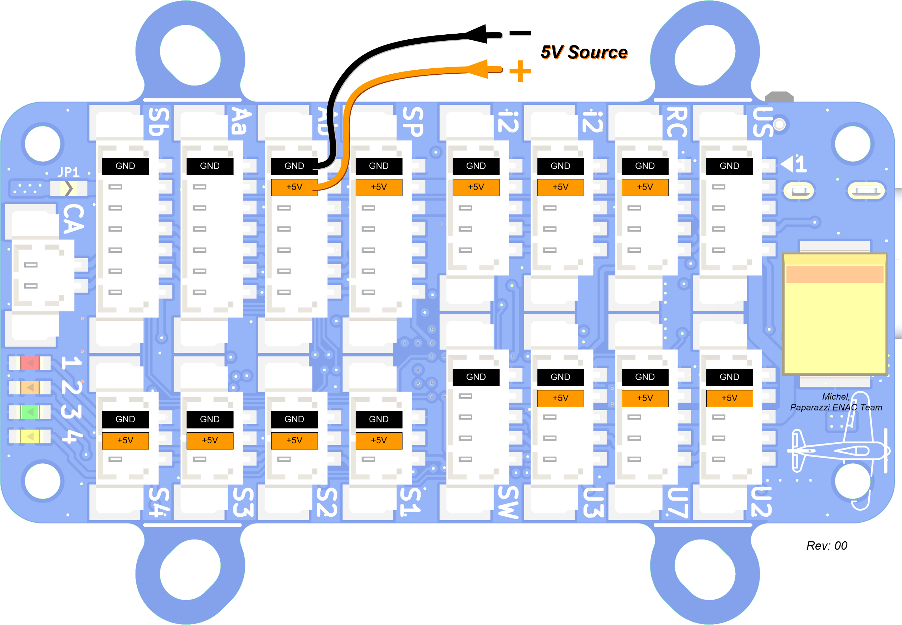

In some cases the external power source is out of range and cannot be used, but an external 5V power source is available (for example provided by the ESC). In this case, the external 5V power source must be connected to the "+5V" and "GND" pins of any header that are equipped with them - with the exception of the "5Vaux" pin of the "AUX a" header.  
**Limitations**:  

- the external 5V power source must be capable of providing the current needed for powering the Tawaki and any potential external payload. With a maximum limit of 1A (because of the headers' specifications)

- voltage range: depending on potential external payload 5V capability, 4-6V for Tawaki board only.
- the "VBUS" pin of the "USB FS" header must not be connected to the "+5V" pin of any header

*Note: with this setup, the voltage of the external power source (VBAT) obviously cannot be measured by the micro-controller (MCU).*

### USB Modes

#### DFU Flash mode

There are two options to boot the autopilot in DFU mode to flash it:

1.  Press and hold the small "BOOT" button.
2.  plug USB cable (already host connected)

OR

1.  Press and hold the small "BOOT" button.
2.  turn on autopilot power source.
3.  plug USB cable.

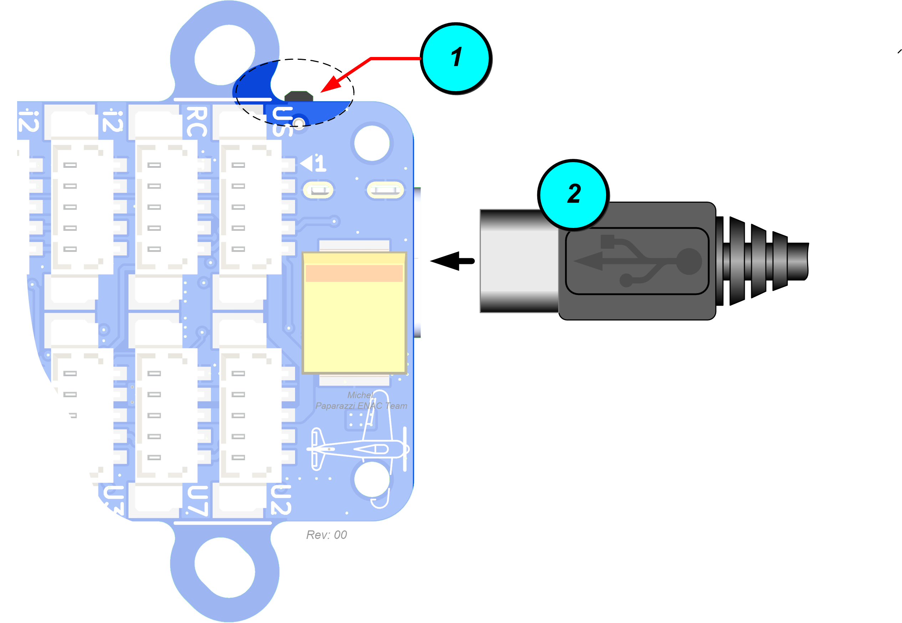

 **OR** 

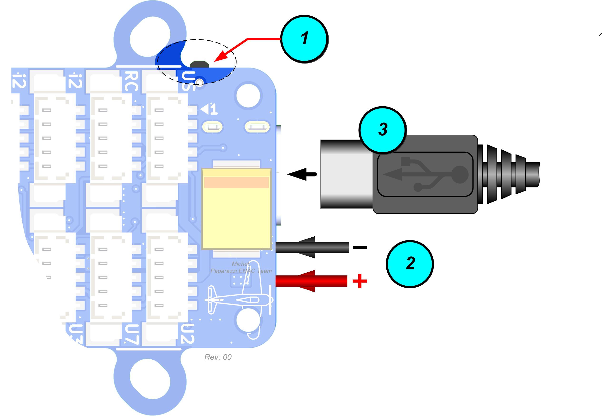

#### USB Storage mode

USB storage mode exposes the autopilot’s microSD card to the host computer as a USB drive.  
To enter in USB storage mode, simply connect it to host computer USB (no action on small button) :

- If autopilot power is OFF, a new external disk drive should be detected by host computer OS.
- If autopilot power is already ON and running, autopilot task is stopped and board enters in USB storage mode. When unmounted and unplugged, the autopilot task restarts.

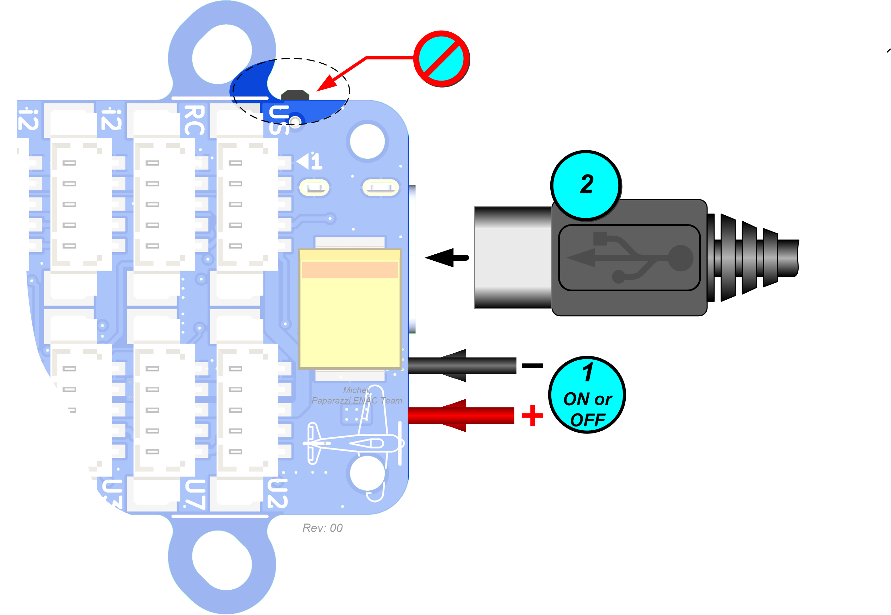

#### Wiring vs Button

For all previous USB modes, small "*BOOT*" push-button action can be replaced by shorting pin \#4 (VBUS) and pin \#5 (BOOT) of "USB FS" header.  
In these configurations (button pushed or pin# 4 & 5 connected), BOOT0 pin of the STM32 MCU is connected to VBUS pin.  
This "USB FS" header arrangement allow to wire a "remote" USB interface (USB receptacle + mode push-button) reasonably distant from autopilot board.  

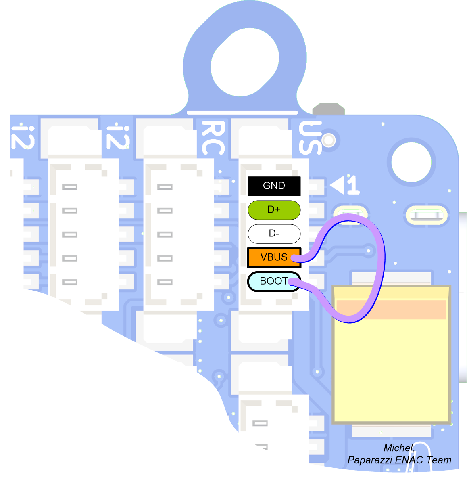

### Detailed Pinout

*Pins Name and Type are specified with respect to the Autopilot Board*  

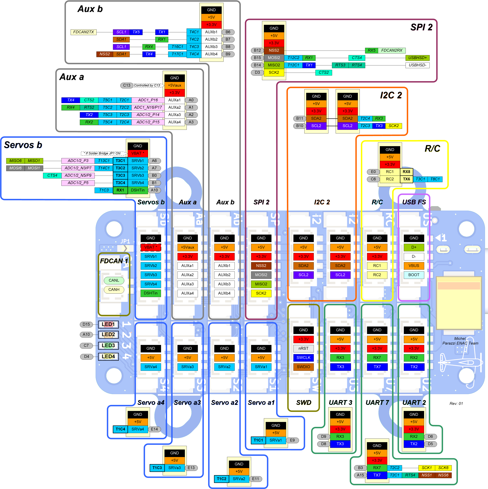

### Schematic

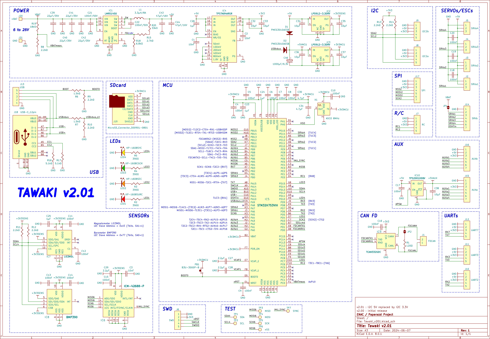

### Mechanical

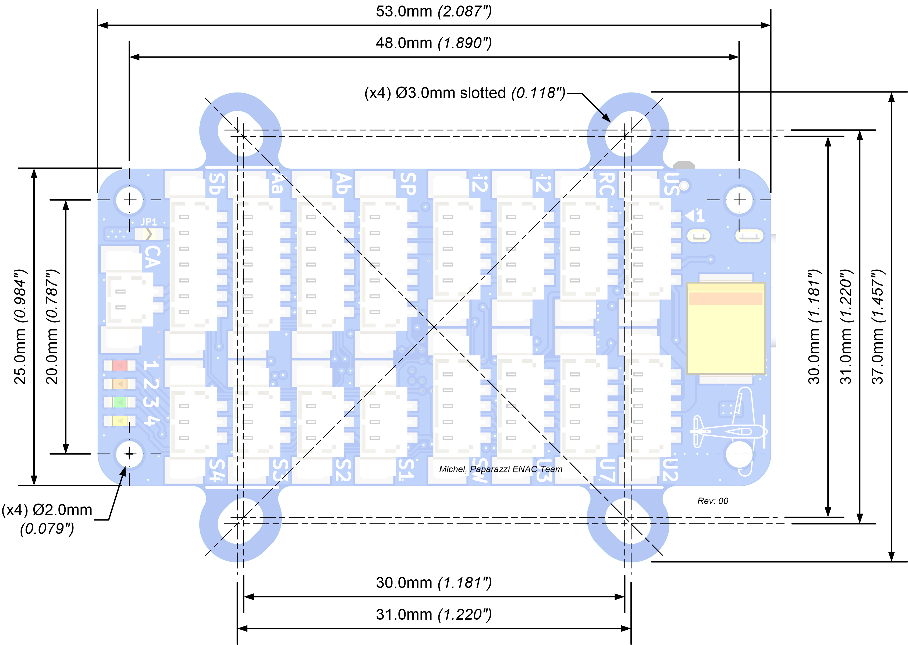

#### CAD Files / 3D Model

Work in progress.

## Board production

Work in progress.

### Hardware Source Files

[*Tawaki v2.01 hardware design (zipped Kicad 8 project)*](http://data.recherche.enac.fr/drones/Paparazzi/hardware/Tawaki_v201.zip)

## Source code

Available in the [Paparazzi source repository](https://github.com/paparazzi/paparazzi/tree/master/sw/airborne/boards/tawaki).

